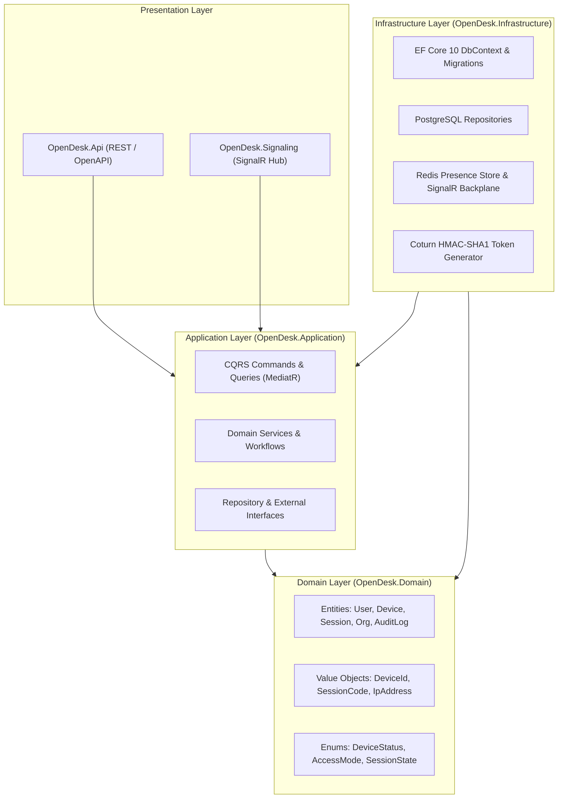

# OpenDesk — Component Architecture Specification

## 1. Monorepo Structural Blueprint

OpenDesk is structured as a polyglot monorepo unifying the Rust core engine, ASP.NET Core backend, Tauri desktop application, Flutter mobile application, and deployment tooling.

```
opendesk/
├── Cargo.toml                       # Top-level Rust workspace configuration
├── OpenDesk.sln                     # Top-level .NET 10 solution
│
├── core/                            # Rust Workspace (Core Engine & Native Services)
│   ├── crates/
│   │   ├── opendesk-proto/          # Shared binary protocol, wire types, serialization
│   │   ├── opendesk-crypto/         # Ed25519 identity, X25519 key exchange, ChaCha20-Poly1305
│   │   ├── opendesk-capture/        # Native screen & audio capture abstraction + implementations
│   │   ├── opendesk-encoder/        # Hardware/software video & audio codec abstraction
│   │   ├── opendesk-input/          # Synthetic mouse & keyboard input injection
│   │   ├── opendesk-transport/      # WebRTC PeerConnection, ICE, SCTP DataChannels
│   │   ├── opendesk-engine/         # High-level engine coordinator unifying capture, encode, transport
│   │   ├── opendesk-ipc/            # Local inter-process communication (Named Pipes / Unix Sockets)
│   │   ├── opendesk-daemon/         # OS privileged background service (Windows Service / systemd)
│   │   ├── opendesk-agent/          # Interactive desktop user session agent
│   │   └── opendesk-cli/            # Headless CLI for diagnostics, pairing, testing
│
├── server/                          # ASP.NET Core 10 Backend Solution
│   ├── src/
│   │   ├── OpenDesk.Domain/         # Core entities, value objects, domain logic
│   │   ├── OpenDesk.Application/    # Use cases, CQRS commands/queries, interfaces
│   │   ├── OpenDesk.Infrastructure/ # EF Core, PostgreSQL persistence, Redis cache, Coturn tokens
│   │   ├── OpenDesk.Signaling/      # SignalR WebSockets Hub, WebRTC signaling coordinator
│   │   ├── OpenDesk.Api/            # ASP.NET Core Web API, REST controllers, OpenAPI specs
│   │   └── OpenDesk.Contracts/      # Shared DTOs, request/response models, event payloads
│   └── tests/
│       ├── OpenDesk.Domain.Tests/
│       ├── OpenDesk.Application.Tests/
│       └── OpenDesk.IntegrationTests/
│
├── clients/
│   ├── desktop/                     # Tauri v2 Desktop Application
│   │   ├── src-tauri/               # Tauri Rust backend crate (links to opendesk-engine)
│   │   └── src/                     # React 19 + TypeScript + Vite frontend
│   │
│   ├── mobile/                      # Flutter 3.x Cross-Platform Mobile Client
│   │   ├── android/                 # Android native host & client bindings
│   │   ├── ios/                     # iOS native client & ReplayKit extension
│   │   └── lib/                     # Dart / Flutter UI & state management
│   │
│   └── web/                         # Browser-based React 19 Remote Desktop Viewer
│
├── deploy/                          # Infrastructure & Deployment Assets
│   ├── docker/                      # Dockerfiles for Server, Coturn, Nginx
│   ├── docker-compose/              # Production & Local Dev Docker Compose stacks
│   ├── k8s/                         # Helm charts & Kubernetes manifests
│   └── certs/                       # Development TLS & Code Signing certificates
│
└── docs/                            # Complete Technical Documentation & Roadmap
```

---

## 2. Rust Workspace Crate Responsibilities

### `opendesk-proto`
- **Role**: Canonical protocol definitions.
- **Dependencies**: `serde`, `bincode`, `bytes`.
- **Exposes**:
  - `ControlMessage`: Handshake, capabilities negotiation, authentication tokens.
  - `InputMessage`: Mouse move (absolute/normalized 0.0-1.0), mouse click (down/up/button), wheel scroll (dx, dy), key down, key up, text composition.
  - `ClipboardMessage`: Text snippet, image chunk, format announcement.
  - `FileTransferMessage`: File metadata, chunk request, chunk payload, cancellation, checksum.
  - `DisplayInfo`: Monitor index, geometry (x, y, width, height), DPI scale, display name.

### `opendesk-crypto`
- **Role**: Cryptographic identity, authenticated key agreement, hashing.
- **Dependencies**: `ed25519-dalek`, `x25519-dalek`, `chacha20poly1305`, `argon2`, `rand_core`, `sha2`.
- **Exposes**:
  - `DeviceKeyPair`: Generates and manages Ed25519 identity keypairs with hardware entropy.
  - `EphemeralSession`: Conducts X25519 ECDH key agreement generating 32-byte symmetric transport keys.
  - `SecureStorage`: Interface for persisting device keys into Windows Credential Manager, macOS Keychain, and Linux Secret Service.

### `opendesk-capture`
- **Role**: Low-level screen frame grabbing and audio loopback acquisition.
- **Dependencies**: Platform conditional compilation (`cfg(target_os = ...)`).
  - Windows: `windows` crate (DXGI 1.2 `IDXGIOutputDuplication`, Windows Graphics Capture `Direct3D11CaptureFramePool`).
  - macOS: `screencapturekit`, `core-graphics`, `core-media`.
  - Linux: `pipewire`, `ashpd` (XDG Desktop Portal), `x11rb` (X11 XShm).
- **Interface**:
  ```rust
  pub trait ScreenCapturer: Send + Sync {
      fn enumerate_displays(&self) -> Result<Vec<DisplayInfo>, CaptureError>;
      fn select_display(&mut self, display_id: u32) -> Result<(), CaptureError>;
      fn capture_frame(&mut self) -> Result<RawFrame, CaptureError>;
  }

  pub trait AudioCapturer: Send + Sync {
      fn start_capture(&mut self, sender: tokio::sync::mpsc::Sender<AudioChunk>) -> Result<(), AudioError>;
      fn stop_capture(&mut self) -> Result<(), AudioError>;
  }
  ```

### `opendesk-encoder`
- **Role**: Hardware-accelerated and software compression for video and audio.
- **Engines**:
  - NVIDIA NVENC via Direct3D11 / CUDA.
  - Intel QuickSync / OneVPL.
  - AMD AMF (Advanced Media Framework).
  - Apple VideoToolbox (Hardware H.264/HEVC on Apple Silicon).
  - Linux VAAPI (`libva`).
  - Software Fallback: OpenH264 (Cisco BSD) or SVT-AV1 / libvpx.
- **Audio Codec**: `audiopus` (Opus 48 kHz dynamic bitrate).

### `opendesk-input`
- **Role**: Synthetic input injection into host operating system.
- **Adapters**:
  - Windows: Win32 `SendInput` API, injecting virtual scancodes, mouse movements with `MOUSEEVENTF_ABSOLUTE`, and touch events.
  - macOS: CoreGraphics `CGEventCreateMouseEvent`, `CGEventCreateKeyboardEvent`, `CGEventPost(kCGHIDEventTap, ...)`.
  - Linux (X11): `XTestFakeKeyEvent`, `XTestFakeMotionEvent`.
  - Linux (Wayland): `libei` (Emulated Input) via `org.freedesktop.portal.RemoteDesktop` D-Bus portal or `/dev/uinput` when running with kernel access.

### `opendesk-transport`
- **Role**: Real-time network transport management over WebRTC.
- **Dependencies**: `webrtc` (pure Rust implementation of libwebrtc protocols).
- **Subsystems**:
  - ICE Agent: STUN binding requests, TURN relay allocation, candidate pair evaluation.
  - DTLS 1.3: Certificate generation, handshake verification against known device public keys.
  - Media Tracks: Video RTP sender/receiver with TWCC (Transport Wide Congestion Control).
  - SCTP Data Channels: Dedicated channels:
    - `opendesk-control`: Session commands and capability flags.
    - `opendesk-input`: High-priority unordered unreliable or low-latency ordered input packets.
    - `opendesk-clipboard`: Reliable ordered clipboard synchronization.
    - `opendesk-file`: Reliable ordered chunked file transfer with backpressure flow control.

### `opendesk-ipc`
- **Role**: High-speed, secure inter-process communication between System Daemon, Desktop Agent, and Host UI.
- **Implementation**:
  - Windows: Named Pipes (`\\.\pipe\opendesk-agent-{session_id}`) secured with ACLs restricting access to `SYSTEM` and the authenticated user.
  - Unix: Unix Domain Sockets located in `/var/run/opendesk/` or `$XDG_RUNTIME_DIR/opendesk.sock` with file permission `0600`.
  - Serialization: High-speed binary framing using `bincode`.

---

## 3. ASP.NET Core Solution Architecture (Clean Architecture)



---

## 4. Desktop Client Architecture (Tauri v2 + React 19)

```
clients/desktop/
├── src-tauri/
│   ├── Cargo.toml                   # Links to opendesk-engine, opendesk-crypto, opendesk-ipc
│   ├── tauri.conf.json              # Window config, security CSP, capability manifests
│   └── src/
│       ├── main.rs                  # Application entry point, system tray, window lifecycle
│       ├── commands/
│       │   ├── session.rs           # Start/stop connection, send input, change quality
│       │   ├── devices.rs           # Query local & remote registered devices
│       │   ├── support.rs           # Generate/validate attended support codes
│       │   └── file_transfer.rs     # Local file browse & transfer queue controls
│       └── render/                  # Native window render hooks for WebRTC video frames
│
└── src/                             # React 19 Frontend
    ├── components/
    │   ├── RemoteViewer/            # Canvas/Webview rendering remote desktop video
    │   ├── OverlayToolbar/          # Floating control bar (Disconnect, Quality, Monitors, Ctrl+Alt+Del)
    │   ├── DeviceGrid/              # Card/list view of user's registered machines
    │   ├── SupportModal/            # Attended session code generator & PIN entry
    │   └── FileManagerModal/        # Side-by-side local & remote file manager
    ├── hooks/
    │   ├── useWebRTC.ts             # WebRTC connection state management
    │   ├── useInputCapture.ts       # Mouse & keyboard event listeners and normalizers
    │   └── usePresence.ts           # Real-time WebSocket device presence updates
    └── stores/                      # Zustand state stores (sessionStore, deviceStore, settingsStore)
```
