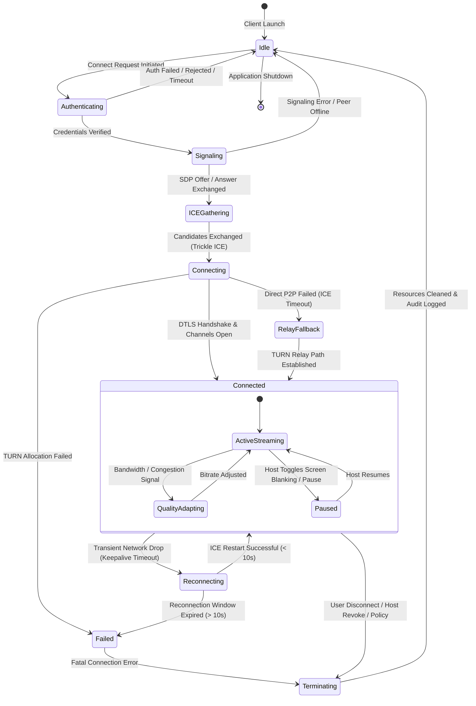

# OpenDesk — Connection Lifecycle & State Machine

## 1. Connection Lifecycle Overview

An OpenDesk remote connection transitions through well-defined phases:
1. **Discovery & Authorization**: Verification of user identity, session codes, or unattended device authorization.
2. **Signaling Handshake**: Exchange of WebRTC SDP Offers/Answers and Trickle ICE candidates via the ASP.NET Core SignalR hub.
3. **Transport Establishment**: ICE connectivity checks, DTLS 1.3 mutual handshake, and SCTP data channel initialization.
4. **Active Session**: Real-time bi-directional streaming of video, audio, input, and files.
5. **Session Maintenance & Resilience**: Continuous heartbeat, TWCC congestion control, and automatic ICE restart upon network disruption.
6. **Termination & Cleanup**: Explicit user disconnect, host revocation, timeout, or security policy enforcement with full resource release.

---

## 2. Connection State Machine

---

## 3. Detailed Phase Breakdown

### Phase 1: Authentication & Authorization
- **Attended Support Mode**:
  1. Client sends session request with 9-digit Session ID and 6-char PIN to `SignalingHub.JoinSupportSession(code, pin)`.
  2. SignalR Hub validates presence and routes request to Host.
  3. Host pops permission dialog. If user clicks "Accept", Host generates authorization token signed with Host's Ed25519 key.
  4. SignalR Hub grants both peers entry to a private ephemeral Signaling Room.
- **Unattended Mode**:
  1. Client submits device connection request with signed token: `SignalingHub.ConnectUnattended(deviceId, signedChallenge)`.
  2. Backend verifies client has ownership or delegation rights on the device.
  3. Host verifies signature against its authorized key list or validates Argon2id pre-shared password hash.
  4. Authorization token emitted; peers enter Signaling Room.

### Phase 2: WebRTC Signaling Negotiation
- The Client creates an SDP Offer configuring:
  - Video Transceiver: RecvOnly, supporting H.264 (profiles 42e01f, 4d001f, 64001f), AV1, VP9.
  - Audio Transceiver: RecvOnly, supporting Opus (48 kHz, stereo).
  - Data Channels: `opendesk-control` (id: 0), `opendesk-input` (id: 1), `opendesk-clipboard` (id: 2), `opendesk-file` (id: 3).
- Host receives Offer, verifies capabilities, configures native capture, and responds with an SDP Answer.
- Both endpoints harvest local, STUN reflex, and TURN relay ICE candidates, streaming them asynchronously (*Trickle ICE*) via SignalR.

### Phase 3: Transport Establishment & DTLS Handshake
- WebRTC ICE agent performs connectivity checks across candidate pairs.
- Priority order:
  1. **Host-to-Host (LAN)**: Direct local subnet communication (RTT < 2 ms).
  2. **Reflexive-to-Reflexive (STUN / P2P WAN)**: UDP hole punching across NAT routers.
  3. **Relayed (TURN / Coturn)**: Encrypted forwarding through coturn relay servers.
- Upon candidate pair nomination, DTLS 1.3 handshake commences. The self-signed DTLS certificates are matched against fingerprint hashes exchanged in the authenticated SDP to eliminate any possibility of Man-in-the-Middle attacks.

### Phase 4: Network Resilience & Handover (ICE Restart)
- **Keepalive Protocol**: Heartbeat packets are exchanged across the `opendesk-control` data channel every 2.0 seconds.
- If no keepalive is acknowledged within 4.0 seconds, the client transitions to the `Reconnecting` state.
- **ICE Restart Procedure**:
  1. The client generates a new SDP Offer with the `ice-restart` flag set.
  2. The offer is transmitted via the fallback signaling channel (SignalR).
  3. New ICE candidates are harvested and evaluated without resetting the active video decoder or UI canvas context.
  4. If ICE recovery succeeds within 10 seconds, the active video track resumes immediately with a newly requested IDR keyframe.
  5. If recovery fails after 10 seconds, the session transitions to `Failed` and prompts the user.

### Phase 5: Graceful Teardown & Security Cleanup
- When either party disconnects:
  1. A `SessionTerminateMessage` is dispatched over the control data channel.
  2. WebRTC PeerConnection, DTLS session, and media tracks are closed.
  3. Native video encoders, capture hooks, and input injection drivers are released.
  4. On unattended hosts: configured post-session actions trigger (e.g., locking the OS desktop, clearing shared clipboard memory).
  5. The SignalR room is destroyed, and the backend records session duration and bandwidth metrics into the audit database.
