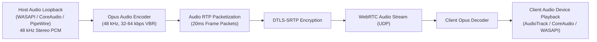
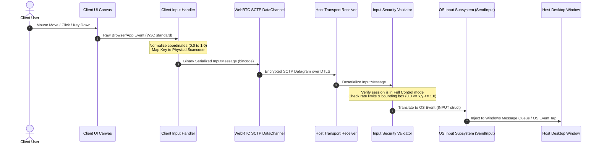
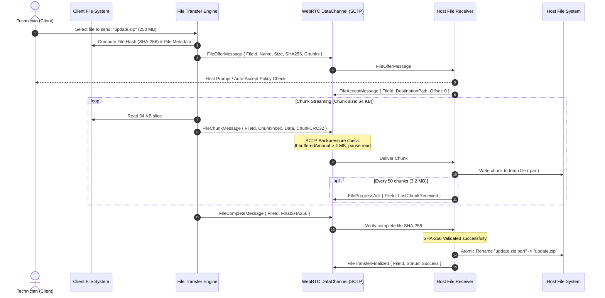

# OpenDesk — Data Flow Architecture

## 1. End-to-End Media Pipeline (Video & Audio)

The media pipeline is engineered for sub-30ms glass-to-glass latency with zero memory copies between the GPU frame buffer and the hardware video encoder wherever supported by the host operating system.

```mermaid
flowchart LR
    subgraph HostPipeline["Host Pipeline (Sender)"]
        GPUCapture["Native Screen Capture\n(DXGI / WGC / SCKit / PipeWire)\nDirectX / Metal Texture"]
        TexFormat["GPU Color Transform\n(BGRA to NV12 / YUV420p)"]
        HWEncoder["Hardware Video Encoder\n(NVENC / AMF / QuickSync / VideoToolbox)\nH.264 / AV1 Stream"]
        RTPPack["RTP Packetization\n& Video MTU Chunking"]
        SRTPEnc["SRTP Encryption\n(AES-128-GCM / ChaCha20)"]
    end

    subgraph NetworkPath["Transport Path"]
        P2P["Direct UDP / WebRTC ICE\n(or Coturn TURN Relay)"]
    end

    subgraph ClientPipeline["Client Pipeline (Receiver)"]
        SRTPDec["SRTP Decryption"]
        JitterBuf["WebRTC Jitter Buffer\n& NACK / PLI Recovery"]
        HWDecoder["Hardware Video Decoder\n(DirectX / Metal / WebCodecs / MediaCodec)"]
        CanvasRender["Zero-Copy Direct3D11 / Metal\nor Webview Canvas Viewport"]
    end

    GPUCapture -->|Direct GPU Texture Pointer| TexFormat
    TexFormat -->|DirectX / Metal Surface| HWEncoder
    HWEncoder -->|Annex-B / NAL Units| RTPPack
    RTPPack --> SRTPEnc
    SRTPEnc --> P2P
    P2P --> SRTPDec
    SRTPDec --> JitterBuf
    JitterBuf -->|Annex-B Frames| HWDecoder
    HWDecoder -->|Decoded Surfaces| CanvasRender
```

### Video Data Flow Steps:
1. **Frame Capture**: Native API acquires the display surface at native display resolution directly into GPU VRAM (e.g., `ID3D11Texture2D` in Windows DXGI).
2. **Color Conversion**: Shader-based pixel format conversion transposes BGRA surfaces to NV12 / YUV420p on the GPU, avoiding CPU memory copies.
3. **Hardware Encoding**: The GPU encoder (e.g. NVENC) compresses the frame in VRAM. It generates an IDR (Keyframe) at session initialization or upon packet loss recovery (PLI/FIR request), followed by continuous P-frames.
4. **Packetization**: The encoded NAL units are segmented into RTP packets adhering to standard MTU limits (typically 1200 bytes to avoid UDP fragmentation).
5. **Encryption & Transmission**: WebRTC encrypts packets via DTLS-SRTP and delivers them across the active ICE candidate pair.
6. **Receiver Depacketization**: The client reassembles RTP packets, checks sequence numbers, triggers NACK requests for missing packets, and delivers frames to the hardware decoder.
7. **Rendering**: Decoded video frames are rendered to the viewport window via native GPU swapchains.

---

## 2. Audio Pipeline Flow

- Audio is captured via OS loopback in 20 ms chunks (960 samples at 48 kHz stereo).
- Compressed using libopus into variable bitrate (VBR) packets averaging 32–64 kbps.
- Lip-sync alignment is maintained by WebRTC RTCP sender reports aligning NTP timestamps between audio and video tracks.

---

## 3. Input Event Data Flow

### Input Normalization Strategy:
- **Mouse Coordinates**: Normalized as 64-bit floating point ratios $(X_{norm}, Y_{norm})$ where $0.0 \le X, Y \le 1.0$. This ensures identical cursor placement regardless of client display resolution, DPI scaling differences, or client window resizing.
- **Keyboard Mapping**: Key events transmit:
  - `code`: W3C physical scancode string (e.g. `KeyA`, `Enter`, `ControlLeft`).
  - `key`: Unicode character value for layout-specific text composition.
  - `modifiers`: Bitflag field: `SHIFT = 1 << 0`, `CTRL = 1 << 1`, `ALT = 1 << 2`, `META = 1 << 3`.

---

## 4. Bidirectional File Transfer Data Flow

File transfer executes over a dedicated reliable, ordered WebRTC SCTP Data Channel (`opendesk-file`), avoiding head-of-line blocking on the media or input channels.

