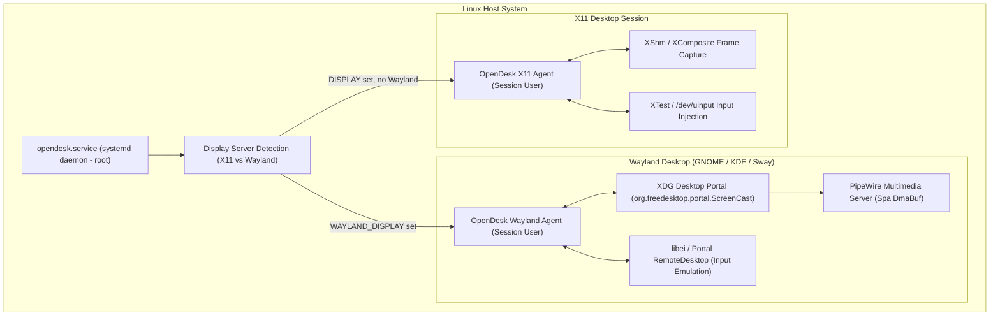

# OpenDesk — Platform-Specific Technical Architecture & Capabilities

## 1. Operating System Capability & Support Matrix

OpenDesk rejects the premise that all operating systems have identical remote control capabilities. Security sandboxing, display server architecture, and permission subsystems vary significantly across modern OS platforms.

| Feature / Capability | Windows 10/11 & Server | Linux (X11) | Linux (Wayland) | macOS (12.3+) | Android (10+) | iOS (16+) |
|---|:---:|:---:|:---:|:---:|:---:|:---:|
| **Screen Capture (Native)** | DXGI / WGC | XShm / XComposite | PipeWire / Portal | ScreenCaptureKit | MediaProjection | ReplayKit Ext. |
| **Hardware Video Encoding** | NVENC/AMF/QSV | VAAPI / NVENC | VAAPI / NVENC | VideoToolbox | MediaCodec | VideoToolbox |
| **System Audio Capture** | WASAPI Loopback | PulseAudio/PipeWire | PipeWire Monitor | CoreAudio Tap | AudioPlaybackCapture | ReplayKit Audio |
| **Global Mouse/Keyboard Inject**| `SendInput` | XTest / `/dev/uinput`| `libei` / Portal | `CGEventPost` | AccessibilityService | ❌ OS Prohibited |
| **Session 0 / Login Screen** | Supported (Winlogon) | Supported (DisplayMgr)| Supported (GDM/SDDM)| Partial (FileVault)| ❌ N/A | ❌ N/A |
| **Unattended Background Host** | Full Service | Full systemd | Full systemd | Full LaunchDaemon | Partial (Doze Mode) | ❌ OS Prohibited |
| **Remote Controller Client** | Full Client | Full Client | Full Client | Full Client | Full Touch Client | Full Touch Client |

---

## 2. Windows Architecture

```
+-----------------------------------------------------------------------------------+
| WINDOWS OPERATING SYSTEM ARCHITECTURE                                             |
|                                                                                   |
|  [ Session 0: Non-Interactive Services ]                                          |
|    - OpenDeskService.exe (LocalSystem Service)                                    |
|      - Holds device private key in Windows Data Protection API (DPAPI)            |
|      - Maintains WebSocket signaling connection with OpenDesk Backend             |
|      - Monitors terminal session events (WTS_CONSOLE_CONNECT, WTS_SESSION_LOGON)  |
|      - When remote connection requested:                                          |
|        - Queries active interactive session ID (WTSGetActiveConsoleSessionId)     |
|        - Spawns Desktop Agent using CreateProcessAsUser with interactive token    |
|                                                                                   |
|  [ Session 1+: Interactive User Desktop (or Winlogon Desktop) ]                   |
|    - OpenDeskAgent.exe (Runs in target session context)                           |
|      - Desktop Capture Pipeline:                                                  |
|        - Primary: Windows Graphics Capture (Windows 10 1903+) via WinRT           |
|        - Secondary: DXGI Desktop Duplication (DirectX 11.1 / IDXGIOutputDuplication)|
|      - Direct3D 11 Texture Binding -> NVENC / AMF / Intel QSV Hardware Encoder    |
|      - Audio Capture: WASAPI Loopback in Shared Mode                              |
|      - Input Injection: Win32 SendInput with Scancode Translation                 |
|      - Secure Desktop / UAC Handling: Uses uiAccess=true signed manifest or       |
|        elevated duplicate token to interact with secure UAC prompts               |
+-----------------------------------------------------------------------------------+
```

### Windows Implementation Specifics:
1. **Screen Capture Dual-Engine**:
   - `Windows Graphics Capture (WGC)`: Preferred for Windows 10/11. Captures Direct3D11 surfaces without screen flicker, supports excluding specific windows (such as OpenDesk's own floating toolbar via `IsBorderRequired = false`), and handles dynamic monitor reconfiguration seamlessly.
   - `DXGI Desktop Duplication`: Used on Windows Server editions or older Windows 10 releases where WGC is unavailable. Direct GPU memory access via `AcquireNextFrame`.
2. **Session 0 & Winlogon Traversal**:
   - Background service detects active desktop switch (`WTS_SESSION_LOCK`, `WTS_SESSION_UNLOCK`).
   - If user is locked or at login, agent launches on `Winlogon` desktop; once logged in, agent hands off to user desktop session without terminating the WebRTC connection.

---

## 3. Linux Architecture (X11 & Wayland)



### Linux Implementation Specifics:
1. **Wayland Support via PipeWire & XDG Portal**:
   - Modern Wayland compositors (Mutter, KWin) prohibit direct screen buffer scraping for security reasons.
   - OpenDesk initiates a D-Bus session with `org.freedesktop.portal.ScreenCast` requesting screen capture.
   - The portal returns a PipeWire stream file descriptor. OpenDesk connects to PipeWire, receiving hardware `DmaBuf` pointers for zero-copy encoding via VAAPI (`libva`).
   - Input injection on Wayland utilizes the standardized `libei` (Emulated Input) protocol negotiated via `org.freedesktop.portal.RemoteDesktop`.
2. **X11 Fallback**:
   - Under standard X11, OpenDesk captures frames via `XShmGetImage` or the XComposite extension.
   - Input is injected via the `XTest` extension (`XTestFakeKeyEvent`, `XTestFakeMotionEvent`) or direct writing to `/dev/uinput` if permission is granted.

---

## 4. macOS Architecture (Monterey 12.3+)

```
+-----------------------------------------------------------------------------------+
| macOS SYSTEM ARCHITECTURE                                                         |
|                                                                                   |
|  [ LaunchDaemon: /Library/LaunchDaemons/com.opendesk.daemon.plist ]               |
|    - Runs as root in background                                                   |
|    - Communicates with OpenDesk backend signaling hub                             |
|    - Coordinates user session agent launch                                        |
|                                                                                   |
|  [ LaunchAgent: /Library/LaunchAgents/com.opendesk.agent.plist ]                  |
|    - Runs in logged-in user Aqua session                                          |
|    - Screen Capture: ScreenCaptureKit (macOS 12.3+)                               |
|      - High-performance, GPU-accelerated capture of displays or windows           |
|      - Direct pixel buffers delivered via SCStreamOutput                          |
|    - Hardware Video Encoding: Apple VideoToolbox framework (VTCompressionSession) |
|      - Hardware H.264 / HEVC encoder on Apple Silicon (M1/M2/M3/M4)               |
|    - Audio Capture: CoreAudio process loopback tap                                |
|    - Input Injection: CoreGraphics Event Tap (CGEventCreate, CGEventPost)         |
|                                                                                   |
|  [ macOS TCC Permission Guardrails ]                                              |
|    - Screen Recording: kTCCServiceScreenCapture (User prompt in System Settings)  |
|    - Accessibility: kTCCServiceAccessibility (Required for synthetic input)      |
+-----------------------------------------------------------------------------------+
```

### macOS Implementation Specifics:
- **ScreenCaptureKit**: The gold standard for macOS screen capture. Delivers `CVImageBufferRef` (IOSurface) frames with zero CPU overhead directly to Apple Silicon hardware encoders.
- **TCC Permission Handling**: macOS strictly enforces that applications cannot capture the screen or inject events without affirmative user consent in *System Settings $\rightarrow$ Privacy & Security*.
- **OpenDesk Guardrail**: If TCC permissions are missing, OpenDesk UI displays an interactive diagnostic checklist with deep links (`x-apple.systempreferences:com.apple.preference.security?Privacy_Accessibility`) to guide the user.

---

## 5. Mobile Architecture: Android & iOS

### Android (Android 10+ / API 29+)
- **Screen Capture**: Utilizes `MediaProjection` API.
  - Requires explicit user consent via an OS-level confirmation dialog displayed on device launch.
  - Encodes video using `MediaCodec` hardware encoder (H.264 baseline/high).
  - Background streaming requires an active `ForegroundService` displaying a persistent notification with `foregroundServiceType="mediaProjection"`.
- **Input Injection (Controlled Mode)**:
  - Requires user to explicitly enable OpenDesk in Android **Accessibility Settings**.
  - Uses `AccessibilityService.dispatchGesture()` to inject clicks, swipes, and multi-touch gestures.
  - **Android Limitation**: Key injection for system keys (Back, Home, Recents) is supported; raw hardware keyboard scancode injection into arbitrary third-party apps is subject to Android OS OEM limitations.

### iOS (iOS 16+)
- **Primary Function**: **Remote Controller Client**. Full-featured touch-to-mouse client for controlling remote Windows, Linux, and Mac desktops.
- **Screen Sharing (View Only)**:
  - Implemented via an iOS **ReplayKit Broadcast Upload Extension**.
  - The user initiates screen broadcast from iOS Control Center. The extension captures video samples (`CMSampleBuffer`) and streams them to the OpenDesk session via App Group shared memory.
- **CRITICAL APPLE ARCHITECTURAL LIMITATION**:
  - iOS sandboxing strictly forbids third-party applications or extensions from injecting synthetic touch events or keystrokes globally into the SpringBoard or into other applications.
  - **OpenDesk strictly documents this limitation**: iOS cannot be operated as an unattended remotely controlled host. Any claim of unattended remote control on un-jailbroken iOS devices is technically impossible and violates Apple App Store Review Guidelines (Guideline 2.5.2).
