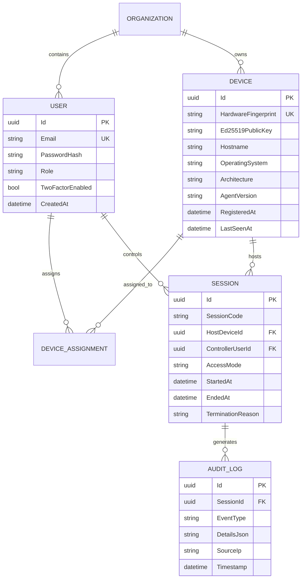

# OpenDesk — Backend Architecture Specification (ASP.NET Core 10)

## 1. Architectural Blueprint & Clean Architecture

The OpenDesk Control Plane is built on **ASP.NET Core 10** utilizing **Clean Architecture** and the **CQRS (Command Query Responsibility Segregation)** pattern. The backend handles authentication, device registration, presence management, session authorization, and WebRTC signaling coordination.

```
server/
├── OpenDesk.Domain/          # Enterprise Business Rules & Entities
│   ├── Entities/             # User, Device, Session, Organization, AuditLog
│   ├── ValueObjects/         # DeviceId, SessionCode, EphemeralKey, IpAddress
│   └── Enums/                # DeviceStatus, SessionState, AccessRole
│
├── OpenDesk.Application/     # Application Business Rules (Use Cases)
│   ├── Common/               # Behaviors (Validation, Logging, Authorization)
│   ├── Devices/              # Commands: RegisterDevice, BindDevice, RevokeDevice
│   ├── Sessions/             # Commands: CreateSupportSession, AuthorizeSession
│   └── Interfaces/           # IDbContext, IRedisPresence, ICoturnTokenService
│
├── OpenDesk.Infrastructure/  # Frameworks & Drivers
│   ├── Persistence/          # EF Core 10 DbContext, PostgreSQL Configurations, Migrations
│   ├── Redis/                # Redis Presence Store, Distributed Cache, SignalR Backplane
│   ├── Security/             # Argon2id Hasher, Ed25519 Signature Verifier, JWT Issuer
│   └── Coturn/               # RFC 5766 Ephemeral TURN Token Generator
│
├── OpenDesk.Signaling/       # Real-Time WebSocket Transport
│   ├── Hubs/                 # SignalingHub (WebSockets / WebTransport)
│   └── Handlers/             # SDP & Trickle ICE Candidate Routing
│
└── OpenDesk.Api/             # Presentation / Web API
    ├── Controllers/          # AuthController, DeviceController, SessionController
    ├── Middleware/           # ExceptionHandler, RateLimiting, DeviceAuthMiddleware
    └── Program.cs            # DI Container & Pipeline Configuration
```

---

## 2. Core Domain Model & Entity Relationships



---

## 3. WebRTC Signaling Hub (`SignalingHub.cs`)

The signaling hub coordinates the initial WebRTC connection setup between the Controller and the Host:

```csharp
namespace OpenDesk.Signaling.Hubs;

[Authorize]
public class SignalingHub : Hub
{
    private readonly ISessionCoordinator _sessionCoordinator;
    private readonly IRedisPresence _presence;
    private readonly ICoturnTokenService _coturnService;

    public SignalingHub(
        ISessionCoordinator sessionCoordinator,
        IRedisPresence presence,
        ICoturnTokenService coturnService)
    {
        _sessionCoordinator = sessionCoordinator;
        _presence = presence;
        _coturnService = coturnService;
    }

    public async Task RegisterHost(string deviceId, string publicKey)
    {
        var connectionId = Context.ConnectionId;
        await _presence.SetHostOnlineAsync(deviceId, connectionId);
        await Groups.AddToGroupAsync(connectionId, $"device_{deviceId}");
    }

    public async Task<TurnCredentialsDto> RequestTurnCredentials()
    {
        var userId = Context.UserIdentifier ?? "anonymous";
        return await _coturnService.GenerateEphemeralCredentialsAsync(userId);
    }

    public async Task SendSdpOffer(string targetDeviceId, string sdpOffer)
    {
        await Clients.Group($"device_{targetDeviceId}")
            .SendAsync("ReceiveSdpOffer", Context.ConnectionId, sdpOffer);
    }

    public async Task SendSdpAnswer(string targetConnectionId, string sdpAnswer)
    {
        await Clients.Client(targetConnectionId)
            .SendAsync("ReceiveSdpAnswer", sdpAnswer);
    }

    public async Task SendIceCandidate(string targetIdentifier, IceCandidateDto candidate)
    {
        await Clients.User(targetIdentifier)
            .SendAsync("ReceiveIceCandidate", candidate);
    }

    public override async Task OnDisconnectedAsync(Exception? exception)
    {
        await _presence.RemoveConnectionAsync(Context.ConnectionId);
        await base.OnDisconnectedAsync(exception);
    }
}
```

---

## 4. Coturn Ephemeral Credential Generator (RFC 5766)

To prevent unauthorized relay bandwidth theft, the backend issues short-lived, authenticated TURN credentials using HMAC-SHA1:

$$\text{Username} = \text{Timestamp} + \text{":"} + \text{UserId}$$
$$\text{Password} = \text{Base64}\Big(\text{HMAC-SHA1}\big(\text{TurnSecretKey},\, \text{Username}\big)\Big)$$

```csharp
namespace OpenDesk.Infrastructure.Coturn;

public class CoturnTokenService : ICoturnTokenService
{
    private readonly string _sharedSecret;
    private readonly string[] _turnUrls;

    public CoturnTokenService(IConfiguration config)
    {
        _sharedSecret = config["Coturn:SharedSecret"] 
            ?? throw new ArgumentNullException("Coturn shared secret missing");
        _turnUrls = config.GetSection("Coturn:Urls").Get<string[]>() 
            ?? new[] { "turn:relay.opendesk.io:3478?transport=udp", "turn:relay.opendesk.io:3478?transport=tcp" };
    }

    public Task<TurnCredentialsDto> GenerateEphemeralCredentialsAsync(string userId)
    {
        // 24 hour expiry
        var expiryTimestamp = DateTimeOffset.UtcNow.AddHours(24).ToUnixTimeSeconds();
        var username = $"{expiryTimestamp}:{userId}";

        using var hmac = new HMACSHA1(Encoding.UTF8.GetBytes(_sharedSecret));
        var hash = hmac.ComputeHash(Encoding.UTF8.GetBytes(username));
        var password = Convert.ToBase64String(hash);

        return Task.FromResult(new TurnCredentialsDto
        {
            Urls = _turnUrls,
            Username = username,
            Credential = password,
            TtlSeconds = 86400
        });
    }
}
```

---

## 5. Redis Presence & Clustering Backplane

In multi-node backend deployments:
- ASP.NET Core SignalR utilizes `Microsoft.AspNetCore.SignalR.StackExchangeRedis` to broadcast messages across all backend nodes seamlessly.
- Device online status is maintained using Redis keys:
  - `device:presence:{deviceId} -> { connectionId, lastHeartbeat, ip }` with an expiry (TTL) of 45 seconds.
  - Heartbeats are refreshed by the host daemon every 20 seconds.
  - Expiry triggers an immediate automated offline notification to all monitoring client dashboards.
