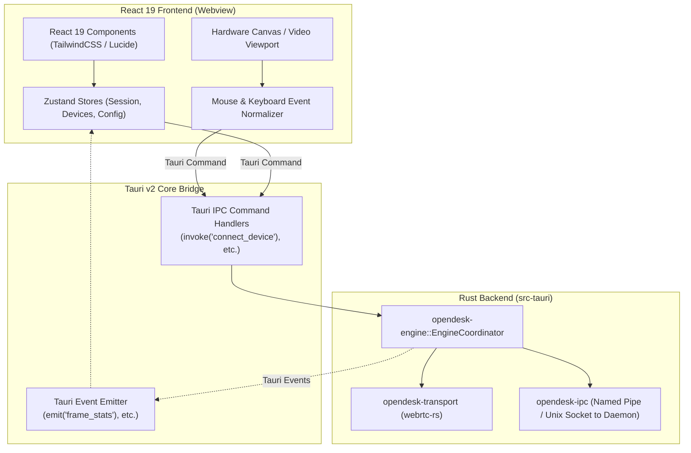

# OpenDesk — Desktop Application Architecture (Tauri v2 + React 19)

## 1. Architectural Model

The OpenDesk Desktop Application provides a lightweight, responsive interface across Windows, macOS, and Linux. Built with **Tauri v2**, **React 19**, and **TypeScript**, the frontend operates inside an OS-native webview while the Rust backend (`src-tauri`) interfaces directly with `opendesk-engine` and the local host daemon via secure IPC.



---

## 2. Desktop Views & Component Hierarchy

### View 1: Main Control Window (`MainWindow`)
- **Connect Panel**:
  - Remote Partner ID entry (9 digits).
  - One-time PIN or Unattended Master Password input.
  - Connect button with instantaneous status feedback.
- **Support Panel ("Allow Remote Support")**:
  - Displays local ephemeral 9-digit Session ID and 6-char PIN.
  - "Copy Invitation Link" action button.
  - Interactive approval dialog upon incoming connection.
- **My Devices Panel ("Fleet Management")**:
  - Real-time online/offline list of registered computers.
  - Host telemetry cards (OS icon, hostname, public IP, CPU/RAM usage, last seen).
  - One-click connect button for paired unattended machines.
- **Settings Panel**:
  - Host unattended access password configuration.
  - Security policies (auto-lock workstation, blank local screen, mute audio).
  - Custom relay/signaling server configuration for self-hosted instances.

### View 2: Remote Viewer Window (`ViewerWindow`)
Launched as an independent, hardware-accelerated Tauri window when a session connects.
- **Canvas Viewport**:
  - Direct rendering of incoming video frames.
  - Dynamic scaling modes: *Fit to Window*, *Original (1:1)*, *Stretch*.
- **Floating Overlay Toolbar**:
  - Draggable, collapsible header bar pinned to top-center of screen.
  - Monitors Switcher: Dropdown to toggle Display 1, Display 2, or All Displays.
  - Session Quality: Low (1 Mbps, 30 FPS) / Balanced (5 Mbps, 60 FPS) / High (15 Mbps, 60 FPS) / Ultra (25 Mbps, 60 FPS).
  - System Actions: Inject `Ctrl+Alt+Del`, `Win/Super Key`, `Lock Screen`.
  - Feature Toggles: [Mute Remote Audio], [Sync Clipboard], [Block Remote Input].
  - File Manager Button: Opens side-by-side file browser modal.
  - Disconnect Button: Immediate graceful teardown.

---

## 3. Tauri IPC Command Interface

Defined in `clients/desktop/src-tauri/src/commands/`:

```rust
#[tauri::command]
pub async fn start_support_session(
    state: tauri::State<'_, AppState>,
) -> Result<SupportCodeResponse, String> {
    state.engine.generate_support_code().await.map_err(|e| e.to_string())
}

#[tauri::command]
pub async fn connect_to_remote(
    partner_id: String,
    auth_credential: AuthCredential,
    state: tauri::State<'_, AppState>,
) -> Result<SessionInfo, String> {
    state.engine.initiate_connection(&partner_id, auth_credential).await
        .map_err(|e| e.to_string())
}

#[tauri::command]
pub async fn send_input_event(
    event: InputMessage,
    state: tauri::State<'_, AppState>,
) -> Result<(), String> {
    state.engine.send_input(event).await.map_err(|e| e.to_string())
}

#[tauri::command]
pub async fn send_file_chunk(
    transfer_id: String,
    chunk_index: u64,
    data: Vec<u8>,
    state: tauri::State<'_, AppState>,
) -> Result<(), String> {
    state.engine.stream_file_chunk(&transfer_id, chunk_index, data).await
        .map_err(|e| e.to_string())
}
```

---

## 4. Frontend State Management (Zustand Store)

```typescript
// clients/desktop/src/stores/sessionStore.ts
import { create } from 'zustand';

interface SessionState {
  status: 'idle' | 'connecting' | 'connected' | 'reconnecting' | 'terminated';
  activePartnerId: string | null;
  remoteDisplays: DisplayInfo[];
  activeDisplayId: number;
  rttMs: number;
  currentFps: number;
  currentBitrateKbps: number;
  isAudioMuted: boolean;
  isClipboardSyncEnabled: boolean;
  
  setConnected: (partnerId: string, displays: DisplayInfo[]) => void;
  updateMetrics: (rtt: number, fps: number, bitrate: number) => void;
  disconnect: () => Promise<void>;
}
```
