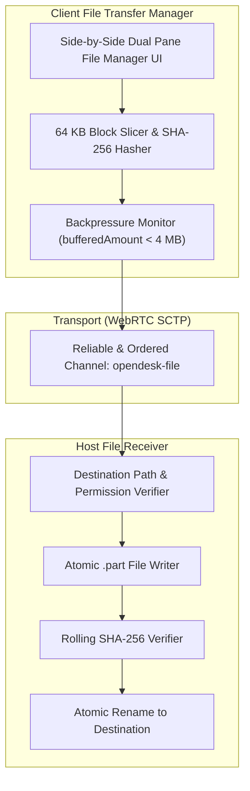

# OpenDesk — File Transfer Engine Specification

## 1. File Transfer Architecture

File transfer operates over a dedicated reliable, ordered WebRTC SCTP Data Channel (`opendesk-file`). It is designed to transfer files ranging from small configuration scripts to multi-gigabyte ISO images with resume support, integrity verification, and backpressure flow control.



---

## 2. File Transfer Wire Protocol Messages

All file transfer messages are serialized using big-endian varint `bincode` and framed with the shared 8-byte protocol header. Message IDs are `0x0301` through `0x0309`, in the order below. File chunks are limited to 64 KiB.

### Message Schema Definition:
```rust
#[derive(Serialize, Deserialize, Debug)]
pub enum FileTransferMessage {
    // Directory Navigation
    ListDirectoryRequest { path: String },
    ListDirectoryResponse { path: String, entries: Vec<FileEntry> },
    
    // File Transfer Negotiation
    FileOffer {
        transfer_id: u64,
        file_name: String,
        file_size_bytes: u64,
        sha256_hash: [u8; 32],
        is_directory: bool,
    },
    FileAccept {
        transfer_id: u64,
        destination_dir: String,
        resume_offset_bytes: u64, // Supports resuming interrupted transfers
    },
    FileReject {
        transfer_id: u64,
        reason: RejectReason,
    },

    // Streaming Chunks
    FileChunk {
        transfer_id: u64,
        chunk_index: u64,
        offset_bytes: u64,
        data: Vec<u8>, // Default: 64 KiB
        crc32: u32,
    },
    FileChunkAck {
        transfer_id: u64,
        acknowledged_chunk_index: u64,
    },

    // Finalization
    FileComplete {
        transfer_id: u64,
        final_sha256: [u8; 32],
    },
    FileCancel {
        transfer_id: u64,
        reason: String,
    },
}
```

---

## 3. Backpressure & Flow Control Strategy

WebRTC SCTP data channels store outbound packets in an internal queue if the network cannot transmit as fast as the local file system reads. Uncontrolled reading will trigger memory exhaustion.

```rust
// OpenDesk Backpressure Loop in opendesk-engine
const MAX_BUFFERED_AMOUNT: usize = 4 * 1024 * 1024; // 4 MiB high-water mark
const RESUME_BUFFERED_AMOUNT: usize = 1 * 1024 * 1024; // 1 MiB low-water mark

while let Some(chunk) = file_reader.read_next_chunk().await? {
    while data_channel.buffered_amount().await > MAX_BUFFERED_AMOUNT {
        // Yield thread and wait until buffer drains below threshold
        tokio::time::sleep(std::time::Duration::from_millis(10)).await;
    }
    data_channel.send(&chunk).await?;
}
```

---

## 4. Security & Path Sanitization

To protect hosts against directory traversal vulnerabilities (e.g. `../../Windows/System32`):
1. **Canonicalization**: The host validates that the target path, once resolved via `std::fs::canonicalize`, resides strictly within authorized destination folders (default: `Downloads/OpenDeskTransfers/` or user-specified folder).
2. **Hidden Files & Executable Permissions**: By default, file creation on Unix hosts explicitly strips the executable bit (`0644`), requiring local user intervention before any downloaded binary can be executed.
3. **Atomic Writes**: Incoming files are written as `.part` files. Only upon full receipt and validation of the matching SHA-256 hash is the file renamed atomically to its destination filename.
