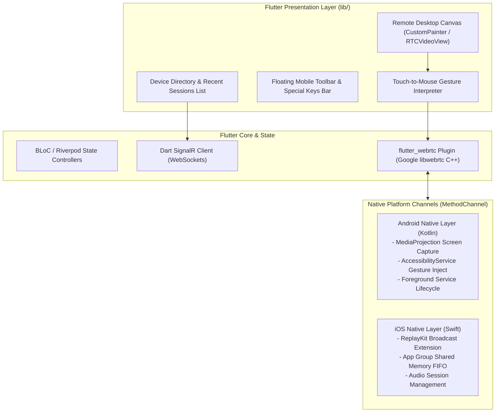

# OpenDesk — Mobile Application Architecture (Flutter 3.x)

## 1. Architectural Strategy

The OpenDesk Mobile Application is developed in **Flutter 3.x / Dart**, delivering high-performance, 60/120 Hz remote desktop control across Android and iOS devices.



---

## 2. Touch-to-Mouse Gesture Translation Modes

Mobile devices operate without physical mice and keyboards. OpenDesk provides two distinct interaction models toggled via the floating toolbar:

### Mode A: Virtual Trackpad Mode (Default & Precision Mode)
- **Concept**: The mobile screen functions as a laptop touchpad.
- **Interactions**:
  - **Single Finger Move**: Moves the remote cursor with non-linear ballistic acceleration (slow swipe = pixel-perfect precision; fast flick = across multiple monitors).
  - **Single Tap**: Left Click at current cursor position.
  - **Double Tap & Hold**: Left Click Drag (e.g., window dragging, text selection).
  - **Two-Finger Tap**: Right Click.
  - **Two-Finger Vertical Scroll**: Smooth mouse wheel scroll (`delta_y`).
  - **Pinch-to-Zoom**: Zooms viewport dynamically onto the cursor focus point.

### Mode B: Direct Touch Mode (Tablet & Stylus Mode)
- **Concept**: Tapping directly on the screen acts like touching that exact coordinate.
- **Interactions**:
  - **Tap**: Relocates cursor to touch coordinate $(X_{norm}, Y_{norm})$ and triggers instantaneous left click.
  - **Long Press**: Triggers right click context menu at coordinate.
  - **Stylus / Apple Pencil Support**: Pressure sensitivity mapped to digital drawing tools on the host.

---

## 3. Mobile Virtual Keyboard & Modifier Bar

To accommodate desktop shortcuts on mobile operating systems without physical modifier keys, OpenDesk displays an ergonomic, customizable overlay bar pinned directly above the mobile soft keyboard:

```
+-----------------------------------------------------------------------------------+
| [Esc]  [Tab]  [Ctrl]  [Alt]  [Shift]  [Win]  [F1..F12]  [Del]  [Ctrl+Alt+Del]  [x] |
+-----------------------------------------------------------------------------------+
|  Q    W    E    R    T    Y    U    I    O    P                                  |
|    A    S    D    F    G    H    J    K    L                                      |
|      Z    X    C    V    B    N    M                                              |
+-----------------------------------------------------------------------------------+
```

- **Sticky Modifiers**: Tapping `Ctrl` or `Alt` latches the modifier state (highlighted in blue), allowing the user to tap `C` on the standard keyboard to trigger `Ctrl+C`, automatically releasing the modifier thereafter.
- **Direct System Injection**: Tapping `[Ctrl+Alt+Del]` sends an atomic system interrupt command to the host.

---

## 4. Platform-Specific Implementations

### Android Host Subsystem
When an Android device operates as a remote host:
1. **MediaProjection Screen Capture**:
   - `MediaProjectionManager.createScreenCaptureIntent()` prompts the user with the mandatory Android screen capture permission dialog.
   - Screen frames are acquired via `ImageReader` or hardware `Surface` and passed to an H.264 `MediaCodec` encoder.
   - The stream runs inside a `ForegroundService` with `FOREGROUND_SERVICE_TYPE_MEDIA_PROJECTION` to prevent the Android Low Memory Killer (LMK) from terminating the session.
2. **Accessibility Input Injection**:
   - Requires enabling OpenDesk in `Settings -> Accessibility`.
   - Injects touch gestures via `AccessibilityService.dispatchGesture(GestureDescription, ...)`.
   - Android back, home, and recent app buttons are triggered via `performGlobalAction(GLOBAL_ACTION_BACK)`, etc.

### iOS Client & Broadcast Extension
- **Client**: High-performance touch controller utilizing Metal-backed rendering via `flutter_webrtc`.
- **Host Broadcast (View Only)**:
  - Operates via an iOS `Broadcast Upload Extension`.
  - Captures video frames from `RPBroadcastSampleHandler.processSampleBuffer()`.
  - Buffers are shared with the main OpenDesk app via an `App Group` memory-mapped ring buffer and piped into WebRTC.
  - **Strict Architectural Limitation**: In accordance with Apple iOS security sandboxing, synthetic input injection outside the OpenDesk app sandbox is prohibited. iOS acts strictly as a remote controller or a screen broadcast host (view-only).
