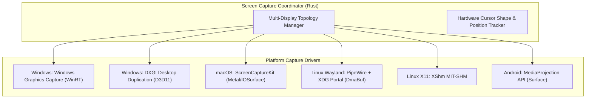

# OpenDesk — Native Screen Capture Subsystem Design

## 1. Multi-Platform Capture Architecture

Screen capture is the most latency-critical component on the host. OpenDesk implements dedicated native capture drivers tailored to each platform's GPU rendering pipeline:



---

## 2. Windows Screen Capture Implementation

### A. Windows Graphics Capture (WGC - Preferred Engine)
- **API**: `Windows.Graphics.Capture.GraphicsCaptureItem` & `Direct3D11CaptureFramePool`.
- **Supported OS**: Windows 10 Version 1903 (Build 18362) and newer; Windows 11.
- **Key Capabilities**:
  - Yellow border suppression: `captureSession.IsBorderRequired = false` (Windows 10 2004+ / Windows 11).
  - Cursor inclusion control: `captureSession.IsCursorEnabled = false` (enables transmitting cursor shapes separately as vector overlays, eliminating cursor latency).
  - Clean window and display capture without desktop tearing or flicker during UAC transitions.

### B. DXGI Desktop Duplication API (Fallback Engine)
- **API**: `IDXGIOutputDuplication::AcquireNextFrame`.
- **Supported OS**: Windows 8 / Server 2012 through Windows 11.
- **Workflow**:
  1. Enumerate adapters (`IDXGIFactory1::EnumAdapters1`) and outputs (`IDXGIAdapter::EnumOutputs`).
  2. Create Direct3D 11 device with `D3D11_CREATE_DEVICE_BGRA_SUPPORT`.
  3. Query `IDXGIOutput1::DuplicateOutput` to obtain an `IDXGIOutputDuplication` handle.
  4. Call `AcquireNextFrame(timeout, &frameInfo, &desktopResource)`.
  5. If `DXGI_ERROR_ACCESS_LOST` is returned (e.g., during mode switch, fullscreen game launch, or secure desktop switch), release handles and re-initialize the duplication pipeline.

---

## 3. macOS Screen Capture Implementation (ScreenCaptureKit)

- **API**: `ScreenCaptureKit.framework` (`SCShareableContent`, `SCStream`, `SCStreamOutput`).
- **Supported OS**: macOS 12.3 Monterey and newer (Apple Silicon & Intel).
- **Architecture**:
  ```swift
  // ScreenCaptureKit Configuration in OpenDesk macOS Driver
  let content = try await SCShareableContent.excludingDesktopWindows(false, onScreenWindowsOnly: true)
  guard let display = content.displays.first(where: { $0.displayID == targetDisplayID }) else { return }

  let config = SCStreamConfiguration()
  config.width = display.width
  config.height = display.height
  config.pixelFormat = kCVPixelFormatType_420YpCbCr8BiPlanarVideoRange // NV12
  config.showsCursor = false // Hardware cursor tracked separately
  config.queueDepth = 3

  let stream = SCStream(filter: SCContentFilter(display: display, excludingApplications: [], exceptingWindows: []),
                        configuration: config,
                        delegate: self)
  try stream.addStreamOutput(self, type: .screen, sampleHandlerQueue: captureQueue)
  try await stream.startCapture()
  ```
- **Zero-Copy Pipeline**: Delivers `CVImageBufferRef` backed by an `IOSurface`. The surface is passed directly to Apple's `VTCompressionSession` for hardware H.264 / HEVC compression without CPU memory duplication.

---

## 4. Linux Screen Capture (Wayland vs. X11)

### A. Wayland Capture via PipeWire & XDG Desktop Portal
Modern Wayland compositors (GNOME Mutter, KDE KWin) block direct framebuffer access.
1. OpenDesk issues a D-Bus request to `org.freedesktop.portal.ScreenCast.CreateSession`.
2. The user or system grants permission to share the screen via the portal dialog.
3. Portal provides an open PipeWire file descriptor and stream node ID.
4. OpenDesk connects to the PipeWire daemon (`libpipewire`), subscribing to the stream node.
5. PipeWire delivers `spa_buffer` frames containing `DmaBuf` pointers, feeding directly into VAAPI (`libva`) hardware encoding.

### B. X11 Capture via MIT-SHM
- Under standard X11, OpenDesk allocates a shared memory segment with `shmget` / `shmat`.
- Frames are acquired via `XShmGetImage`.
- While CPU-based, MIT-SHM avoids round-trip socket copying between Xorg and OpenDesk.

---

## 5. Multi-Monitor Topology & Cursor Rendering

```
+-----------------------------------------------------------------------------------+
| VIRTUAL DESKTOP COORDINATE SPACE                                                  |
|                                                                                   |
|  [ Display 1: 1920x1080 @ (0, 0) ]        [ Display 2: 2560x1440 @ (1920, 0) ]    |
|  +--------------------------------+       +------------------------------------+  |
|  |                                |       |                                    |  |
|  |                                |       |                                    |  |
|  |                                |       |                                    |  |
|  +--------------------------------+       +------------------------------------+  |
+-----------------------------------------------------------------------------------+
```

- **Independent Capture Streams**: Each monitor is treated as a distinct capture source. The controller client can switch active monitor streams or view all displays in a unified viewport.
- **Hardware Cursor Separation**:
  - Rather than baking the cursor into video frames (which causes visual stutter at low framerates), OpenDesk captures the cursor bitmap, hotspot offset, and coordinates independently.
  - Cursor updates are sent via the low-latency SCTP data channel.
  - The client renders the cursor locally at the client screen's native refresh rate (up to 144 Hz).
