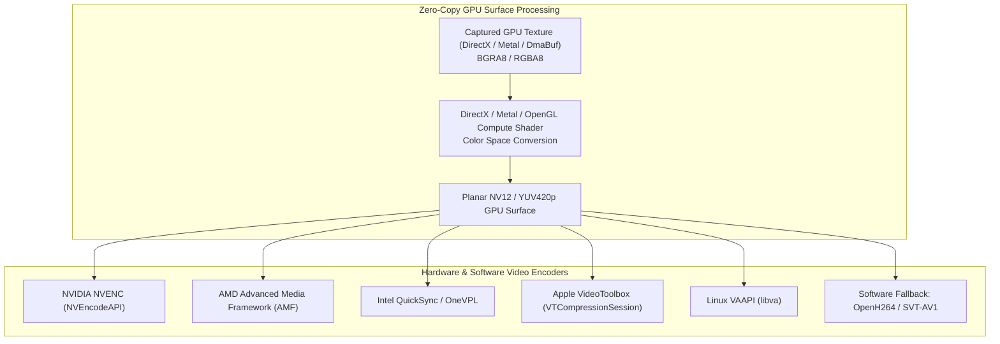
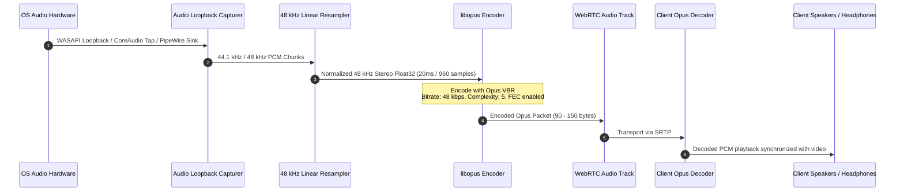

# OpenDesk — Video & Audio Streaming Subsystems

## 1. Hardware Video Encoding Architecture

Real-time remote desktop requires encoding display frames within a strict 2–5 millisecond encoding budget to preserve sub-30ms glass-to-glass latency.



---

## 2. Hardware Encoder Parameters & Optimization

### NVIDIA NVENC Configuration
- **API**: NVIDIA Video Codec SDK (NVEncodeAPI).
- **Preset**: `NV_ENC_PRESET_P1` or `NV_ENC_PRESET_P2` (Lowest latency, single-pass).
- **Tuning Info**: `NV_ENC_TUNING_INFO_ULTRA_LOW_LATENCY`.
- **Rate Control**: `NV_ENC_PARAMS_RC_CBR` (Constant Bitrate) with dynamic bitrate adjustment.
- **GOP Structure**:
  - `gopLength = NVENC_INFINITE_GOPLENGTH`.
  - Continuous P-frames; IDR keyframes emitted strictly on session start or explicit RTCP Picture Loss Indication (PLI).
  - B-frames disabled (`frameIntervalP = 1`) to eliminate frame reordering latency.

### Apple VideoToolbox Configuration
- **API**: `VTCompressionSessionCreate`.
- **Properties**:
  ```c
  VTSessionSetProperty(session, kVTCompressionPropertyKey_RealTime, kCFBooleanTrue);
  VTSessionSetProperty(session, kVTCompressionPropertyKey_ProfileLevel, kVTProfileLevel_H264_High_AutoLevel);
  VTSessionSetProperty(session, kVTCompressionPropertyKey_AverageBitRate, (__bridge CFNumberRef)@(targetBitrateBps));
  VTSessionSetProperty(session, kVTCompressionPropertyKey_MaxKeyFrameInterval, (__bridge CFNumberRef)@(3600)); // Keyframes on demand
  VTSessionSetProperty(session, kVTCompressionPropertyKey_AllowFrameReordering, kCFBooleanFalse);
  ```

---

## 3. Audio Streaming Architecture (Opus Codec)



### Audio Specifications:
- **Sample Rate**: 48,000 Hz stereo.
- **Frame Duration**: 20 milliseconds (960 samples per channel).
- **Codec Profile**: `OPUS_APPLICATION_RESTRICTED_LOWDELAY` (minimizes internal algorithmic delay to < 5ms).
- **Forward Error Correction (FEC)**: In-band FEC enabled to reconstruct lost audio packets seamlessly over lossy wireless networks.
