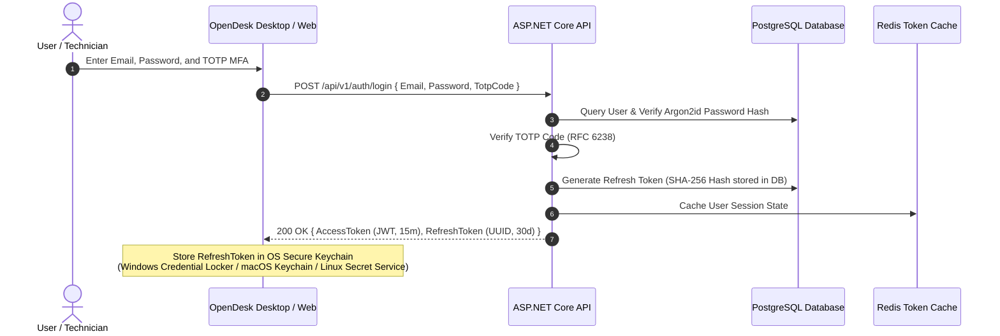

# OpenDesk — Authentication Architecture & Identity Protocols

## 1. User Identity & Token Management

User authentication in OpenDesk is handled by the ASP.NET Core 10 backend utilizing cryptographic JSON Web Tokens (JWT) and secure rotating refresh tokens:

---

## 2. Multi-Factor Authentication (MFA) Standards

1. **Time-Based One-Time Password (TOTP - RFC 6238)**:
   - Supported across Google Authenticator, Microsoft Authenticator, 1Password, and Bitwarden.
   - HMAC-SHA1 with 30-second time steps and 6-digit codes.
2. **FIDO2 / WebAuthn Hardware Security Keys**:
   - Supported via WebAuthn API on Web and Desktop clients.
   - Requires physical presence verification (YubiKey, Touch ID, Windows Hello).
   - Eliminates phishing and credential replay attacks.

---

## 3. Remote Support Session Authentication (Codes & PINs)

To facilitate spontaneous technical support without requiring end-users to register accounts:
- **Session Code**: 9 numeric digits formatted as `XXX-XXX-XXX` (e.g. `482-195-302`), providing $10^9$ discrete combinations.
- **Session PIN**: 6 cryptographically random uppercase alphanumeric characters (excluding ambiguous characters: `0`, `O`, `1`, `I`, `L`), yielding $32^6 \approx 1.07 \times 10^9$ entropy combinations.
- **Combined Entropy**: $> 1.07 \times 10^{18}$ total possible session credentials.

### Anti-Brute-Force & Rate-Limiting Rules:
1. **Sliding Window Lockout**: Redis tracks failed PIN verification attempts per IP and per Session Code.
2. **Failure Threshold**: After **5 incorrect PIN attempts**:
   - The Session Code is instantly invalidated and deleted from Redis.
   - The requesting client IP is throttled for 15 minutes.
   - An alert notification is dispatched to the host UI.
3. **Time-To-Live (TTL)**: Unclaimed support codes automatically expire after **10 minutes**.
