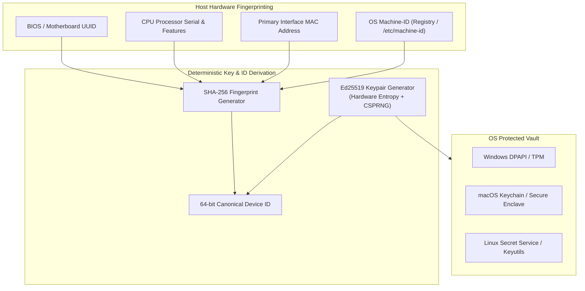

# OpenDesk — Cryptographic Device Identity Specification

## 1. Device Identity Architecture

Every device running OpenDesk generates an immutable, cryptographically verifiable identity composed of:
1. **Device ID**: A unique, persistent 64-bit integer formatted as a 9-digit canonical identifier.
2. **Ed25519 Identity Keypair**: An asymmetric keypair used to sign device registration payloads, presence heartbeats, and connection authorizations.

---

## 2. Platform Hardware Fingerprinting Implementations

To ensure device fingerprints remain stable across minor driver updates or network adapter changes while preventing identity spoofing:

### A. Windows Fingerprint Sources
- BIOS UUID via WMI: `Win32_ComputerSystemProduct.UUID`.
- OS Machine GUID: `HKEY_LOCAL_MACHINE\SOFTWARE\Microsoft\Cryptography\MachineGuid`.
- CPU Processor ID: `Win32_Processor.ProcessorId`.

### B. Linux Fingerprint Sources
- System Machine ID: `/etc/machine-id` or `/var/lib/dbus/machine-id`.
- DMI System UUID: `/sys/class/dmi/id/product_uuid` (requires read permissions).
- Root filesystem UUID: Extracted via `blkid` on root mount `/`.

### C. macOS Fingerprint Sources
- Hardware UUID via IOKit: `IOPlatformUUID` from `IOPlatformExpertDevice`.
- Hardware Serial Number: `IOPlatformSerialNumber`.

---

## 3. Asymmetric Keypair Generation & Secure Storage

Upon initial startup of the OpenDesk host service:
1. `opendesk-crypto` generates an Ed25519 keypair using operating system cryptographically secure random number generators (`getrandom` / `BCryptGenRandom` / `SecRandomCopyBytes`).
2. The **Public Key** (32 bytes) is hex-encoded and registered with the OpenDesk control plane.
3. The **Private Key** (32 bytes) is stored strictly in platform-native secure vaults:
   - **Windows**: Protected using DPAPI (`CryptProtectData`) with `CRYPTPROTECT_LOCAL_MACHINE` scope for background service daemons.
   - **macOS**: Stored in the macOS System Keychain with access restricted to the OpenDesk daemon bundle identifier (`kSecAttrService = "com.opendesk.daemon"`).
   - **Linux**: Stored in `/etc/opendesk/identity.key` with file mode `0400` owned exclusively by `root:root`.

---

## 4. Connection Attestation Protocol

When a controller initiates a connection to a host:
1. Signaling Hub delivers a cryptographic nonce ($N_C$, 32 bytes) from the controller to the host.
2. The host signs the tuple $(N_C, \text{Timestamp}, \text{SessionID})$ using its Ed25519 private key:
   $$\sigma = \text{Sign}\Big(\text{HostPrivateKey},\, N_C \parallel \text{Timestamp} \parallel \text{SessionID}\Big)$$
3. The host transmits $\sigma$ and its public key to the controller.
4. The controller verifies $\sigma$ against the host's public key recorded in the central directory service.
5. If the signature is valid, the connection proceeds; if verification fails or the public key does not match, the session is terminated immediately, alerting the user to a potential impersonation attack.
