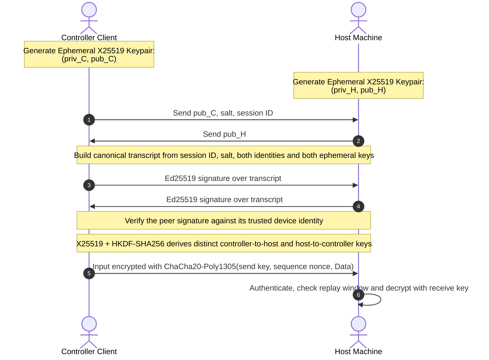

# OpenDesk — Cryptography & End-to-End Encryption Specification

## 1. Cryptographic Standard & Ciphersuites

OpenDesk adopts modern, post-RSA cryptographic standards designed to eliminate side-channel timing attacks and deliver high performance across desktop and mobile architectures:

```
+-----------------------------------------------------------------------------------+
| OPENDESK CRYPTOGRAPHIC SUITE SPECIFICATION                                       |
+--------------------------+-----------------------+--------------------------------+
| Function                 | Algorithm Standard    | Parameter / Configuration      |
+--------------------------+-----------------------+--------------------------------+
| Asymmetric Identity      | Ed25519 (RFC 8032)    | Curve25519, SHA-512            |
| Key Agreement (ECDH)     | X25519 (RFC 7748)     | Montgomery curve, 256-bit      |
| Symmetric Data Channel   | ChaCha20-Poly1305     | RFC 8439, 256-bit Key, 96b IV  |
| WebRTC Transport Enc.    | DTLS 1.3 (RFC 9147)   | TLS_AES_128_GCM_SHA256 /       |
|                          |                       | TLS_CHACHA20_POLY1305_SHA256   |
| Real-time Media Framing  | SRTP (RFC 3711)       | AEAD_AES_128_GCM / AES-CTR     |
| Password Hashing         | Argon2id (RFC 9106)   | m=64MB, t=3 passes, p=4 lanes  |
| Key Derivation           | HKDF-SHA256 (RFC 5869)| Extract-and-Expand             |
| File Chunk Integrity     | SHA-256 (FIPS 180-4)  | 32-byte rolling chunk hash     |
+--------------------------+-----------------------+--------------------------------+
```

---

## 2. Ephemeral End-to-End Key Agreement (E2EE)

Even though WebRTC establishes DTLS 1.3 transport encryption, OpenDesk implements an **application-layer End-to-End Encryption (E2EE)** envelope for all sensitive data channels (Input, Clipboard, File Transfer). The application layer authenticates ephemeral exchange keys with the peers' Ed25519 device identities so a signaling or relay service cannot substitute its own keys. The remote identity must be checked against an authenticated device record or user-approved fingerprint.



The initiator generates a fresh 32-byte salt using the operating system CSPRNG and includes it, a 16-byte session ID, both Ed25519 identities, and both ephemeral public keys in the signed transcript. The `opendesk-crypto` crate rejects non-contributory peer keys and mismatched transcript identities. HKDF expands the shared secret into two direction-specific keys. Each direction uses a monotonically increasing 64-bit sequence in a 96-bit nonce; the receiver allows bounded reordering (64 sequence positions) and rejects duplicate or stale messages. Envelopes are encoded as `nonce (12 bytes) || ciphertext || Poly1305 tag (16 bytes)`. Callers must bind protocol context such as channel and message type as AEAD associated data. Both peers must create fresh ephemeral keys and salt for every session.

---

## 3. Password Hashing Specification (Argon2id)

When configuring unattended access with a pre-shared master password, the password is never stored or transmitted in plaintext.

### Verification Parameters:
- **Algorithm**: `Argon2id` (v0x13).
- **Memory Cost ($m$)**: $65,536\text{ KiB}$ (64 MiB).
- **Time Cost ($t$)**: $3\text{ iterations}$.
- **Parallelism ($p$)**: $4\text{ threads}$.
- **Salt**: 16 bytes generated via CSPRNG.
- **Hash Output Length**: 32 bytes.

These parameters require $> 50\text{ ms}$ on a modern CPU to compute a single hash, rendering offline dictionary and GPU rainbow table attacks computationally intractable.
