# OpenDesk — Security Architecture & Principles

## 1. Zero-Trust Security Philosophy

OpenDesk operates on the foundational premise that the network is hostile, intermediary servers may be compromised or operated by third parties, and endpoints must explicitly authenticate and authorize every interaction.

```
+-----------------------------------------------------------------------------------+
| OPENDESK ZERO-TRUST SECURITY LAYERS                                               |
+-----------------------------------------------------------------------------------+
| Layer 1: Cryptographic Device Identity (Ed25519 Hardware-Bound Keypairs)          |
| Layer 2: Authenticated Key Exchange (Ephemeral X25519 ECDH per Session)           |
| Layer 3: End-to-End Encrypted Transport (DTLS 1.3 / SRTP / ChaCha20-Poly1305)     |
| Layer 4: Zero-Knowledge Relay Infrastructure (Opaque Coturn Datagram Forwarding)  |
| Layer 5: Segregated Authorization Models (Attended Consent vs. Unattended Keys)   |
| Layer 6: Operating System Isolation & Least Privilege (Session 0 / TCC / Portals) |
| Layer 7: Tamper-Evident Immutable Audit Logging (Signed Audit Event Streams)      |
+-----------------------------------------------------------------------------------+
```

---

## 2. Segregated Trust Models: Attended vs. Unattended

A central security flaw in legacy remote desktop tools is treating temporary technical support sessions as a stepping stone to permanent unattended access. OpenDesk strictly segregates these authorization models:

```mermaid
graph TD
    subgraph SupportModel["Attended Remote Support (Ephemeral Trust)"]
        HostUser["Interactive Host User"]
        CodePIN["9-Digit Code + 6-Char PIN (10 min TTL)"]
        ConsentDialog["Visual Consent Prompt (Explicit 'Accept')"]
        KillSwitch["Persistent On-Screen Kill Switch Banner"]
    end

    subgraph UnattendedModel["Unattended Administrative Access (Persistent Trust)"]
        DeviceKey["Ed25519 Device Hardware Key"]
        MasterSecret["Argon2id Master Password OR Account User Key"]
        OrgPolicy["Organization IP Allowlist & FIDO2 MFA"]
        AutoLock["Mandatory Post-Session Auto-Lock"]
    end

    HostUser --> CodePIN
    CodePIN --> ConsentDialog
    ConsentDialog --> KillSwitch

    DeviceKey --> MasterSecret
    MasterSecret --> OrgPolicy
    OrgPolicy --> AutoLock
```



### Absolute Invariant:
**A temporary support session cannot alter the host's unattended access credentials or register the host to a new user account without a distinct, elevated, interactive re-authentication ritual on the host machine.**

---

## 3. Defense-in-Depth Implementation

### Transport & Relay Security
- **DTLS 1.3 (RFC 9147)**: Protects all peer-to-peer and relayed WebRTC data.
- **Relay Zero-Knowledge**: The coturn relay cluster receives only encrypted UDP/TCP packets. Even in the event of an attacker seizing total control of all relay servers, they cannot inspect video frames, capture keystrokes, or inject commands.
- **Signaling Channel Security**: SignalR WebSocket connections run over TLS 1.3 with strict certificate pinning options.

### OS Least Privilege & Sandboxing
- **Windows**: The elevated Windows Service handles IPC coordination, but screen capture and input injection execute inside a dedicated user-session Desktop Agent.
- **macOS**: Adheres strictly to Apple Transparency, Consent, and Control (TCC) for Screen Recording and Accessibility. OpenDesk will never attempt to exploit private APIs or bypass TCC prompts.
- **Linux**: Adheres to modern Wayland security paradigms using XDG Desktop Portals (`ScreenCast` and `RemoteDesktop`/`libei`), avoiding unsafe global X11 grabs where possible.
