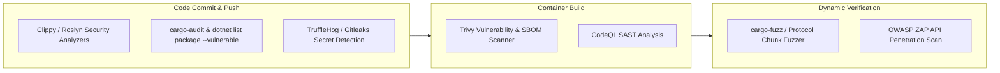

# OpenDesk — Security Verification, Penetration Testing & Fuzzing

## 1. Automated Security Pipeline (DevSecOps)

Security verification is integrated into every continuous integration (CI) workflow:



---

## 2. Protocol Fuzzing Strategy (`cargo-fuzz` & `libFuzzer`)

The binary protocol parser (`opendesk-proto`) and the SCTP input deserializer must be rigorously fuzzed against malformed, truncated, and malicious binary payloads to prevent memory safety panics or buffer overruns:

```rust
// core/crates/opendesk-proto/fuzz/fuzz_targets/fuzz_input_parser.rs
#![no_main]
use libfuzzer_sys::fuzz_target;
use opendesk_proto::input::InputMessage;

fuzz_target!(|data: &[u8]| {
    // Attempt deserialization of arbitrary fuzzed byte slices
    if let Ok(message) = bincode::deserialize::<InputMessage>(data) {
        // Invariant: Deserialized coordinates must be valid finite floats
        if let InputMessage::MouseMove { x_norm, y_norm, .. } = message {
            assert!(x_norm.is_finite());
            assert!(y_norm.is_finite());
        }
    }
});
```

---

## 3. Mandatory Penetration Test Cases

| Test Case ID | Test Objective | Execution Method | Expected Result |
|---|---|---|---|
| **SEC-TC-01** | Zero-Knowledge Relay Sniffing | Capture raw PCAP traffic at coturn relay container during active 1080p60 stream. Attempt extraction of video or keystrokes using Wireshark and custom scripts. | **Pass**: All media packets appear as opaque DTLS-SRTP ciphertext. 0% frame reconstruction possible without endpoint private keys. |
| **SEC-TC-02** | File Path Traversal | Client crafted with malicious SCTP payload requests file write to `../../../../Windows/System32/evil.dll`. | **Pass**: Host path canonicalization rejects relative paths with `403 PathTraversalForbidden`. File written strictly to authorized sandbox. |
| **SEC-TC-03** | Attended Escalation Rejection | Client sends unattended password update command while connected via attended support session code. | **Pass**: Command rejected with `401 UnauthorizedSessionScope`. Host UI displays immediate security warning. |
| **SEC-TC-04** | Input Flood Rate Limiting | Client transmits 100,000 synthetic mouse clicks per second over data channel. | **Pass**: Token bucket limits host injection to 1,000 events/sec. Host CPU remains responsive; excessive packets dropped. |
| **SEC-TC-05** | Cryptographic Replay Attack | Intercept signed device attestation packet and replay it 60 seconds later to establish unauthorized connection. | **Pass**: Replay fails due to timestamp expiration ($\Delta t > 10\text{s}$) and unique cryptographic nonce validation in Redis. |
