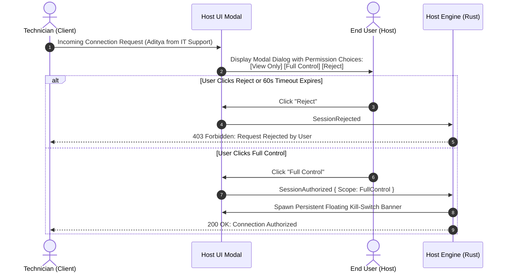

# OpenDesk — Session Authorization & Access Revocation Specification

## 1. Authorization Scope Models

Every OpenDesk session is governed by an explicit `SessionPermissionScope` granted at connection initiation and enforced continuously:

| Permission Scope | Screen View | Audio Hear | Mouse / Keyboard Control | Clipboard Sync | File Transfer | Remote Reboot |
|---|:---:|:---:|:---:|:---:|:---:|:---:|
| **View Only** | ✅ Yes | ✅ Yes | ❌ Blocked | ❌ Blocked | ❌ Blocked | ❌ Blocked |
| **Interactive Control** | ✅ Yes | ✅ Yes | ✅ Yes | ✅ Yes | ❌ Blocked | ❌ Blocked |
| **File Transfer Only** | ❌ Blocked | ❌ Blocked | ❌ Blocked | ❌ Blocked | ✅ Yes | ❌ Blocked |
| **Full Administrative** | ✅ Yes | ✅ Yes | ✅ Yes | ✅ Yes | ✅ Yes | ✅ Yes |

---

## 2. Attended Support Authorization Flow



---

## 3. Real-Time Access Revocation Mechanisms

OpenDesk provides three independent layers of session termination:

### 1. Host Emergency Kill Switch (Local Override)
- During an active remote session, the host display features a persistent floating red bar: **"Aditya is connected — [Disconnect Immediately]"**.
- Clicking this button immediately:
  - Closes all WebRTC channels at the OS network level.
  - Terminates the interactive session agent process.
  - Clears host clipboard memory.
  - Drops the remote technician instantly.

### 2. Centralized Control Plane Revocation
- Administrators can view all active sessions across an organization from the Web Dashboard.
- Clicking **"Terminate Session"** issues an authenticated SignalR broadcast to the host daemon:
  ```csharp
  // OpenDesk.Api Session Revocation Handler
  [HttpPost("api/v1/sessions/{sessionId}/revoke")]
  [Authorize(Roles = "Admin,SuperAdmin")]
  public async Task<IActionResult> RevokeSession(Guid sessionId)
  {
      await _mediator.Send(new RevokeSessionCommand(sessionId, User.GetUserId()));
      return NoContent();
  }
  ```
- The host daemon receives the revocation event and instantly destroys the WebRTC context.

### 3. Device Unbinding & Credential Wipe
- When an administrator unbinds a compromised or decommissioned device:
  - The device's public key is marked revoked in PostgreSQL.
  - Active Redis presence tokens are purged.
  - The host daemon is instructed to purge its local private key and credentials, resetting the client to an unconfigured state.
