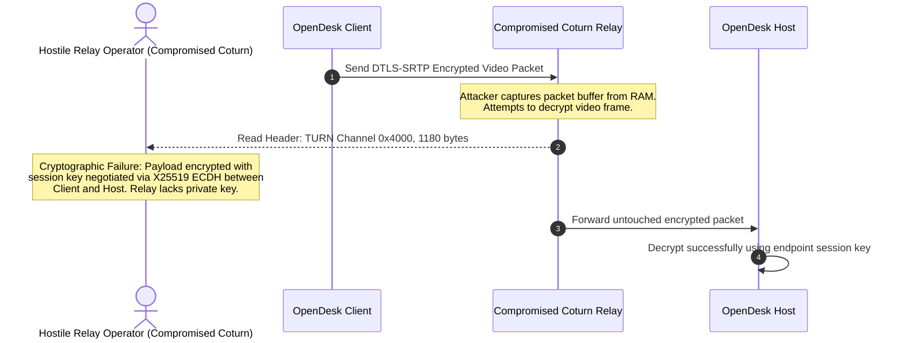

# OpenDesk — Threat Model & Security Risk Analysis (STRIDE)

## 1. STRIDE Threat Analysis Matrix

OpenDesk applies Microsoft STRIDE threat modeling to identify attack surfaces and enforce architectural mitigations:

| STRIDE Category | Threat Description | Attack Vector | OpenDesk Architectural Mitigation |
|---|---|---|---|
| **Spoofing** | Attacker impersonates a trusted host to capture technician credentials. | Malicious host registers duplicate device ID on signaling hub. | Devices sign identity challenges using hardware-stored **Ed25519 private keys**. Device ID is mathematically bound to public key fingerprint. |
| **Spoofing** | Attacker impersonates an authorized technician to access unattended hosts. | Stolen JWT token or intercepted session code. | Access tokens expire in 15 minutes; unattended access requires signed client challenge verifying possession of user account private key; mandatory MFA. |
| **Tampering** | Man-in-the-Middle (MitM) modifies video or input frames in transit. | Malicious relay node or compromised ISP modifies WebRTC packets. | **DTLS 1.3 mutual authentication** with SDP certificate fingerprint verification. Packet modification triggers immediate cryptographic integrity failure and connection drop. |
| **Repudiation** | Rogue technician denies initiating an unauthorized remote connection. | Technician deletes local client logs. | Server-side **append-only immutable audit log** in PostgreSQL recording session duration, client IP, user ID, and cryptographic session hashes. |
| **Information Disclosure**| Eavesdropper captures sensitive desktop contents or keystrokes. | Packet sniffing on public Wi-Fi or compromised relay server. | End-to-end encryption via **SRTP (AES-128-GCM)** and **SCTP over DTLS 1.3**. Relays operate strictly on opaque datagrams without decryption keys. |
| **Denial of Service** | Attacker exhausts relay server bandwidth. | Unauthenticated client requests massive TURN relay allocations. | Coturn enforces **RFC 5766 HMAC-SHA1 ephemeral credentials** issued exclusively by authenticated ASP.NET Core backend; sliding window rate limiting. |
| **Denial of Service** | Input event flooding freezes the host operating system. | Malicious client transmits 500,000 mouse events/sec over data channel. | Host-side token bucket rate limiter caps input injection to **1,000 events/second**; excess events are dropped with an alert. |
| **Elevation of Privilege**| Technician during temporary support session gains permanent host access. | Client invokes device registration command during attended support. | Segregated authorization models; attended session token cannot write to unattended credential vault; host UI requires local administrator prompt. |
| **Elevation of Privilege**| File transfer writes arbitrary files into Windows System32 / Startup. | Directory traversal payload (`../../Windows/System32/cmd.exe`). | Strict path canonicalization; all incoming files restricted to authorized sandbox folder (`Downloads/OpenDesk/`); executable bit stripped on Unix. |

---

## 2. Relay Compromise Scenario (Zero-Knowledge Validation)

- **Conclusion**: A completely compromised relay node cannot compromise the confidentiality or integrity of user sessions.
