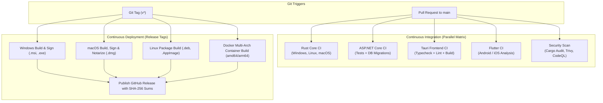

# OpenDesk — CI/CD Pipeline & Build Automation Specification

## 1. GitHub Actions Pipeline Architecture

OpenDesk employs a matrix CI/CD pipeline ensuring strict compilation, testing, security scanning, and automated cross-platform release artifact generation:



---

## 2. Matrix Build Strategy (`.github/workflows/ci-core.yml`)

```yaml
name: Rust Core Engine CI

on:
  push:
    branches: [ main, develop ]
    paths: [ 'core/**', 'Cargo.toml', 'Cargo.lock' ]
  pull_request:
    branches: [ main ]
    paths: [ 'core/**', 'Cargo.toml', 'Cargo.lock' ]

jobs:
  test-matrix:
    name: Test on ${{ matrix.os }}
    runs-on: ${{ matrix.os }}
    strategy:
      fail-fast: false
      matrix:
        os: [ windows-latest, ubuntu-latest, macos-latest ]

    steps:
      - uses: actions/checkout@v4

      - name: Install Rust Toolchain
        uses: dtolnay/rust-toolchain@stable
        with:
          components: clippy, rustfmt

      - name: Cache Cargo Dependencies
        uses: Swatinem/rust-cache@v2

      - name: Check Formatting
        run: cargo fmt --all --check

      - name: Clippy Linter
        run: cargo clippy --workspace --all-targets -- -D warnings

      - name: Run Unit Tests
        run: cargo test --workspace --verbose
```

---

## 3. Code Signing & Release Verification Standards

1. **Windows**: Executables and installers (`.msi`) are signed via Azure Trusted Signing or EV Code Signing Certificate using `signtool.exe`.
2. **macOS**: Binaries are signed with Apple Developer ID Application certificates and submitted to Apple Notary Service (`xcrun notarytool submit`) with stapled notarization tickets.
3. **Linux**: Debian packages (`.deb`) and AppImages are signed using the OpenDesk Release GPG Key.
4. **Attestation**: All release artifacts emit verifiable SLSA Level 3 provenance attestations via GitHub Actions OIDC tokens.
