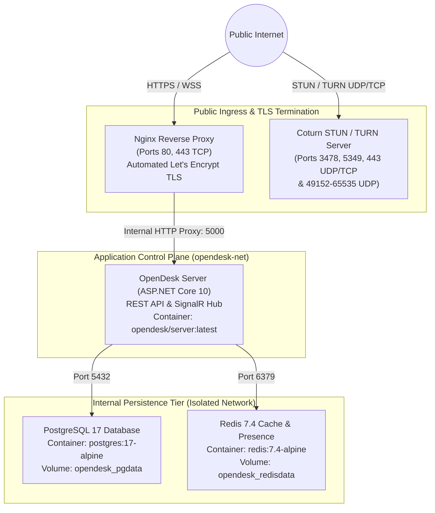

# OpenDesk — Docker Architecture & Container Topology

## 1. Containerized Infrastructure Topology

OpenDesk utilizes a unified container architecture across both local self-hosted instances and multi-tenant cloud deployments:



---

## 2. Production Docker Compose (`docker-compose.yml`)

```yaml
version: '3.8'

networks:
  opendesk-public:
    driver: bridge
  opendesk-internal:
    internal: true

volumes:
  opendesk_pgdata:
  opendesk_redisdata:
  opendesk_certs:
  opendesk_nginx_conf:

services:
  # 1. Reverse Proxy & TLS Ingress
  nginx:
    image: nginx:alpine
    container_name: opendesk-nginx
    restart: unless-stopped
    ports:
      - "80:80"
      - "443:443"
    volumes:
      - ./nginx/nginx.conf:/etc/nginx/nginx.conf:ro
      - opendesk_certs:/etc/letsencrypt
    networks:
      - opendesk-public
    depends_on:
      - server

  # 2. OpenDesk ASP.NET Core 10 Control Plane
  server:
    image: opendesk/server:latest
    container_name: opendesk-server
    restart: unless-stopped
    environment:
      - ASPNETCORE_ENVIRONMENT=Production
      - ConnectionStrings__DefaultConnection=Host=postgres;Port=5432;Database=opendesk;Username=opendesk;Password=${POSTGRES_PASSWORD}
      - Redis__Configuration=redis:6379,password=${REDIS_PASSWORD}
      - Coturn__SharedSecret=${COTURN_SHARED_SECRET}
      - Coturn__Urls__0=turn:${SERVER_DOMAIN}:3478?transport=udp
      - Coturn__Urls__1=turn:${SERVER_DOMAIN}:3478?transport=tcp
      - Jwt__SecretKey=${JWT_SECRET_KEY}
    networks:
      - opendesk-public
      - opendesk-internal
    depends_on:
      postgres:
        condition: service_healthy
      redis:
        condition: service_healthy

  # 3. PostgreSQL 17 Persistence
  postgres:
    image: postgres:17-alpine
    container_name: opendesk-postgres
    restart: unless-stopped
    environment:
      - POSTGRES_DB=opendesk
      - POSTGRES_USER=opendesk
      - POSTGRES_PASSWORD=${POSTGRES_PASSWORD}
    volumes:
      - opendesk_pgdata:/var/lib/postgresql/data
    networks:
      - opendesk-internal
    healthcheck:
      test: ["CMD-SHELL", "pg_isready -U opendesk -d opendesk"]
      interval: 5s
      timeout: 5s
      retries: 5

  # 4. Redis 7.4 Presence & Signaling Backplane
  redis:
    image: redis:7.4-alpine
    container_name: opendesk-redis
    restart: unless-stopped
    command: redis-server --requirepass ${REDIS_PASSWORD} --appendonly yes
    volumes:
      - opendesk_redisdata:/data
    networks:
      - opendesk-internal
    healthcheck:
      test: ["CMD", "redis-cli", "-a", "${REDIS_PASSWORD}", "ping"]
      interval: 5s
      timeout: 5s
      retries: 5

  # 5. Coturn STUN/TURN Relay Server
  coturn:
    image: coturn/coturn:latest
    container_name: opendesk-coturn
    restart: unless-stopped
    network_mode: "host" # High-throughput UDP relay requires host networking
    environment:
      - COTURN_SHARED_SECRET=${COTURN_SHARED_SECRET}
      - SERVER_DOMAIN=${SERVER_DOMAIN}
      - EXTERNAL_IP=${EXTERNAL_IP}
    volumes:
      - ./coturn/turnserver.conf:/etc/turnserver.conf:ro
```
