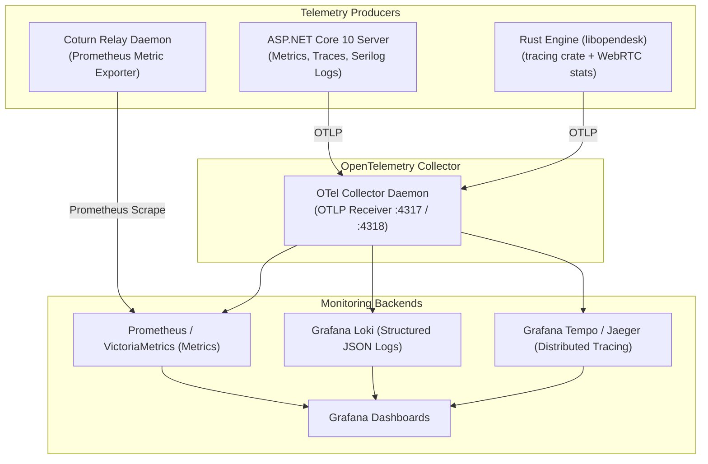

# OpenDesk — Observability, Telemetry & Monitoring Architecture

## 1. Observability Stack Overview

OpenDesk implements comprehensive observability using the **OpenTelemetry (OTel)** standard across both the backend control plane and client endpoints:



---

## 2. Core Operational Metrics & KPIs

| Metric Name | Type | Unit | Description |
|---|:---:|:---:|---|
| `opendesk_active_sessions_total` | Gauge | Count | Current active sessions broken down by mode (`direct_p2p`, `turn_relay`). |
| `opendesk_connection_setup_seconds` | Histogram | Seconds | Time from session initiation to first decoded video frame. |
| `opendesk_media_rtt_milliseconds` | Gauge | Milliseconds | Real-time round-trip latency measured via RTCP sender reports. |
| `opendesk_media_fps` | Gauge | FPS | Actual rendered video frames per second. |
| `opendesk_media_bitrate_kbps` | Gauge | Kbps | Actual transmitted video and audio bitrate. |
| `opendesk_packet_loss_ratio` | Gauge | Ratio (0.0-1.0) | Fraction of RTP packets lost across the transport link. |
| `opendesk_coturn_allocations_active` | Gauge | Sockets | Number of active TURN relay socket pairs on coturn nodes. |

---

## 3. Health Probes & Readiness Checks

The ASP.NET Core server exposes standardized health check endpoints compliant with Kubernetes and Docker Compose:
- **Liveness Probe** (`/health/live`): Returns `200 OK` if the HTTP process is running.
- **Readiness Probe** (`/health/ready`): Evaluates connectivity to PostgreSQL, Redis, and Coturn secret validation:
  ```json
  {
    "status": "Healthy",
    "totalDuration": "00:00:00.0125000",
    "entries": {
      "postgresql": { "status": "Healthy", "duration": "00:00:00.0041000" },
      "redis": { "status": "Healthy", "duration": "00:00:00.0018000" }
    }
  }
  ```
