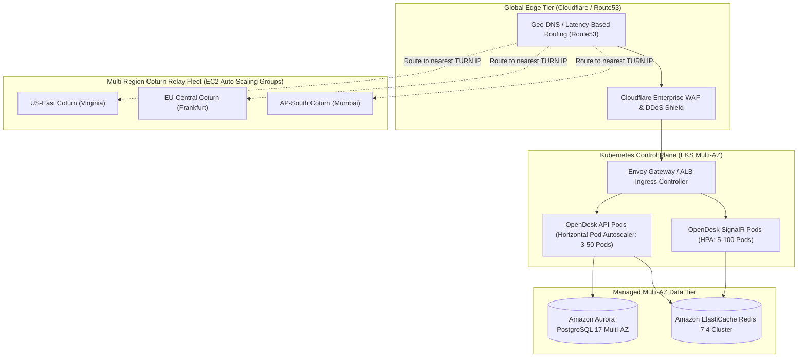

# OpenDesk — Public Cloud Multi-Tenant Architecture

## 1. Cloud Infrastructure Overview

The OpenDesk Public Cloud utilizes an identical application codebase to the self-hosted edition, deployed on Kubernetes (EKS / GKE) with managed database clusters and globally distributed relay nodes:

---

## 2. Horizontal Scaling & High Availability

1. **SignalR WebSocket Clustering**:
   - Backend signaling nodes scale horizontally using `Microsoft.AspNetCore.SignalR.StackExchangeRedis`.
   - Pods are stateless. If a signaling pod crashes, clients immediately reconnect to another pod; state is maintained in Redis.
2. **Geo-Distributed Coturn Fleet**:
   - Media relay nodes run on bare-metal or compute-optimized EC2 instances (`c6in.2xlarge` with 25 Gbps network interfaces) located in 8 AWS regions globally.
   - The backend `CoturnTokenService` queries the connecting client's GeoIP and issues TURN credentials targeting the closest geographic relay node.
