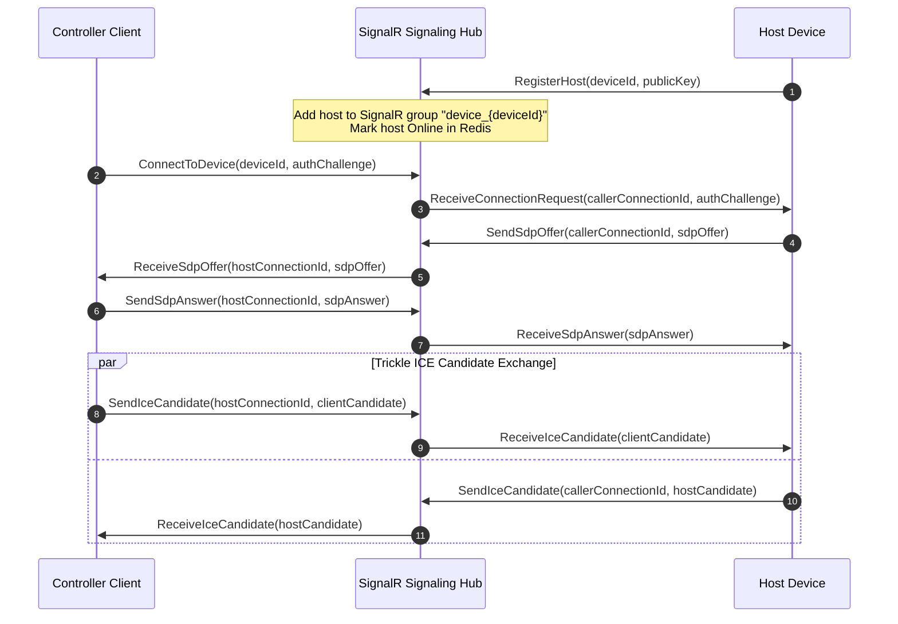

# OpenDesk — Real-Time Signaling Events & SignalR Hub Contract

## 1. Hub Connection & Endpoint

- **Signaling Endpoint**: `wss://desk.yourdomain.com/hubs/signaling`
- **Transport**: WebSockets (Primary), Long-Polling (Fallback).
- **Authentication**: JWT Access Token supplied via query parameter `?access_token=<JWT>` or `Authorization` header.

---

## 2. Client-to-Server Method Invocations



---

## 3. Server-to-Client Event Schemas

### `ReceiveSdpOffer`
```json
{
  "sourceConnectionId": "W7g8A9s2B3",
  "sdpOffer": {
    "type": "offer",
    "sdp": "v=0\r\no=- 4829104 2 IN IP4 127.0.0.1\r\ns=-\r\nt=0 0\r\na=group:BUNDLE 0 1 2\r\n..."
  }
}
```

### `ReceiveIceCandidate`
```json
{
  "candidate": "candidate:842163 1 udp 1677729535 192.168.1.150 54128 typ host generation 0",
  "sdpMid": "0",
  "sdpMLineIndex": 0
}
```

### `DevicePresenceChanged`
Broadcast to all authorized controllers when a device state updates:
```json
{
  "deviceId": "482-195-302",
  "isOnline": true,
  "lastSeenAt": "2026-11-15T21:47:00Z"
}
```
