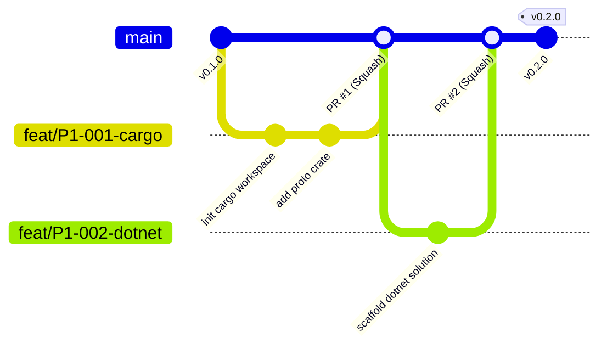

# OpenDesk — Branching Strategy & Contribution Workflow

## 1. Trunk-Based Development with Short-Lived Branches

OpenDesk adheres to a **Trunk-Based Development** workflow to maximize velocity, prevent long-lived merge conflicts, and ensure continuous integration:

---

## 2. Branch Naming Conventions

All development branches must be prefixed with their intent and associated task ID:
- `feat/P{Phase}-{TaskID}-{short-slug}` (e.g. `feat/P1-001-cargo-workspace`)
- `fix/P{Phase}-{TaskID}-{short-slug}` (e.g. `fix/P3-004-dxgi-access-lost`)
- `docs/{short-slug}` (e.g. `docs/update-webrtc-guide`)
- `chore/{short-slug}` (e.g. `chore/upgrade-rust-1.83`)

---

## 3. Pull Request & Merge Invariants

1. **Short Lifespan**: Branches must be merged within 48 hours of creation. Large features must be divided into smaller, independently buildable PRs.
2. **Squash and Merge**: Commits are squashed upon merge into `main` to preserve a clean, linear git history.
3. **Automated Quality Gate**: Merging requires:
   - Green CI status on all matrix jobs (Rust cross-compilation, .NET tests, Tauri build).
   - Code coverage delta must not decrease.
   - At least 1 approved review from a codeowner.
