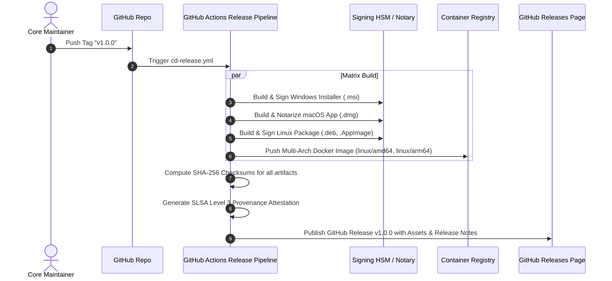

# OpenDesk — Release Management & Distribution Process

## 1. Semantic Versioning & Release Cadence

OpenDesk strictly adheres to **Semantic Versioning 2.0.0** (`vMAJOR.MINOR.PATCH`):
- **MAJOR**: Incompatible API or protocol changes breaking older clients.
- **MINOR**: Backward-compatible new features (e.g. adding AV1 hardware codec support).
- **PATCH**: Backward-compatible bug fixes and security hardening.

### Release Cadence:
- **Nightly Releases**: Automated builds from `main` for early adopters.
- **Stable Minor Releases**: Scheduled every 4 weeks.
- **Security Hotfixes**: Deployed out-of-band within 24 hours of vulnerability mitigation.

---

## 2. Release Execution Runbook

---

## 3. Post-Release Verification

1. Download published `.msi` and `.dmg` on clean test machines (non-developer VMs).
2. Verify SmartScreen / Gatekeeper passes cleanly without untrusted publisher warnings.
3. Pull `opendesk/server:1.0.0` container and execute `docker compose up -d` against test database.
4. Verify client auto-updater detects the new version and updates seamlessly.
