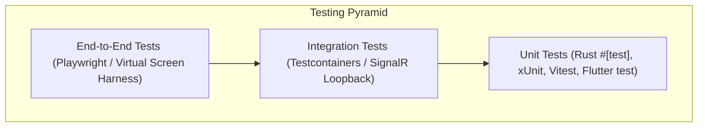

# OpenDesk — Comprehensive Testing Strategy

## 1. Testing Pyramid & Methodology

OpenDesk enforces a four-tier automated testing pyramid ensuring rock-solid stability from low-level bit parsing to full glass-to-glass streaming:

---

## 2. Testing Levels Breakdown

### 1. Unit Testing
- **Rust Engine**: Tests protocol serialization/deserialization, cryptographic signatures, coordinate math, rate limiters, and frame buffer transformations.
  - Executed via: `cargo test --workspace`.
- **Backend API**: Tests business logic, MediatR command validators, JWT token issuance, and Argon2id password verification using **xUnit**, **FluentAssertions**, and **Moq**.
  - Executed via: `dotnet test server/OpenDesk.sln`.
- **Frontend**: Tests React UI state, Zustand stores, and input normalization using **Vitest** and **React Testing Library**.
  - Executed via: `pnpm test`.

### 2. Integration Testing (Testcontainers & WebRTC Loopback)
- **Database & Cache**: Integration tests run against real PostgreSQL 17 and Redis 7.4 containers spun up on-demand via **Testcontainers for .NET**.
- **WebRTC Loopback Test**: In-process loopback where a virtual Rust capture source connects to a Rust receiver over a local WebRTC PeerConnection, verifying video frame delivery, bitrate adaptation, and SCTP channel integrity without external network dependencies.

### 3. Network Degradation & Chaos Testing
To guarantee resilience over real-world mobile and satellite links, automated tests execute under synthetic network conditions using `tc-netem` and Toxiproxy:
- **Test Scenarios**:
  - $5\%$ to $20\%$ random packet loss: Must trigger PLI/FIR and adapt bitrate without session drop.
  - $150\text{ ms}$ jitter and latency spikes: Evaluates WebRTC jitter buffer behavior.
  - Sudden IP handover (Wi-Fi to LTE simulation): Evaluates ICE restart recovery within 10 seconds.
