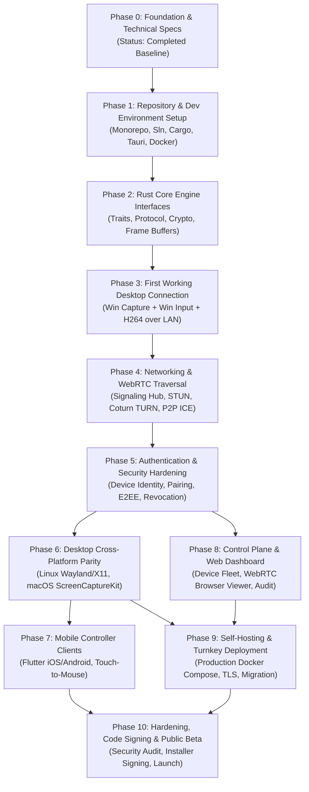

# OpenDesk — Master Phased Implementation Roadmap

## 1. Executive Implementation Strategy

The development of **OpenDesk** is executed strictly phase by phase. To avoid fragile architectures and ensure continuous stability, implementation strictly adheres to the principle: **Plan completely. Implement incrementally. Test everything. Document every change.**

---

## 2. Phase Summary Matrix

| Phase | Title | Primary Focus | Key Deliverable | Complexity | Status |
|---|---|---|---|:---:|:---:|
| **Phase 0** | Architecture & Foundation | System specifications, threat model, protocol design | Complete technical documentation | High | **Completed** |
| **Phase 1** | Repository & Dev Setup | Monorepo scaffolding, compilers, CI/CD, Docker | All projects build & pass health checks | Medium | Ready to start |
| **Phase 2** | Rust Core Engine | Abstraction traits, protocol serialization, crypto | Modular, unit-tested `libopendesk` | High | Dependent on P1 |
| **Phase 3** | Desktop Remote Access | Windows DXGI/WGC capture, SendInput, H.264 stream | Working Windows P2P streaming over LAN | High | Dependent on P2 |
| **Phase 4** | Networking & Connectivity | SignalR signaling, ICE candidate harvesting, Coturn | WAN connections across firewalls | High | Dependent on P3 |
| **Phase 5** | Authentication & Security | Ed25519 identity, pairing, E2EE, kill switch | Zero-trust session authorization | High | Dependent on P4 |
| **Phase 6** | Desktop Cross-Platform | Linux PipeWire/X11, macOS ScreenCaptureKit | Linux & macOS native host/clients | Very High | Dependent on P5 |
| **Phase 7** | Mobile Applications | Flutter iOS & Android clients, touch translation | Functional mobile remote controllers | High | Dependent on P5 |
| **Phase 8** | Backend & Web Dashboard | Fleet management, presence, audit logs, web viewer | Complete account and device portal | Medium | Dependent on P5 |
| **Phase 9** | Self-Hosting & Deployment | Docker Compose, Coturn setup, backup runbooks | One-command turnkey self-hosting | Medium | Dependent on P6, P8 |
| **Phase 10** | Hardening & Public Beta | Load testing, security audit, code signing, packages | Production-ready v1.0.0 Public Beta | High | Dependent on all |
