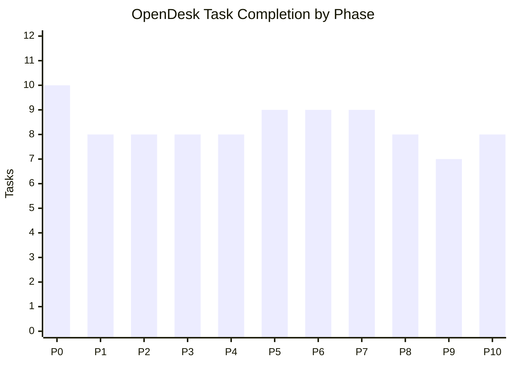

# OpenDesk — Phased Implementation Progress Tracker

This document provides a live dashboard tracking the implementation status, completion metrics, and operational notes for every phase of OpenDesk development.

---

## 1. Master Implementation Summary Table

| Phase | Phase Name | Status | Completed Tasks | Total Tasks | Completion % | Milestone Notes |
|:---:|---|:---:|:---:|:---:|:---:|---|
| **Phase 0** | Architecture & Project Foundation | **Completed** | 10 | 10 | 100% | Full architectural specification, PRD, security model, and roadmap baseline established. |
| **Phase 1** | Repository & Dev Setup | **Completed** | 8 | 8 | 100% | All projects build; desktop, mobile, Rust, and API tests pass; local services healthy; CI workflow configured. |
| **Phase 2** | Rust Core Engine Interfaces | **Not Started** | 0 | 8 | 0% | Traits, binary protocol, Ed25519/X25519 crypto, rate limiters. |
| **Phase 3** | Desktop Remote Access (Win) | **Not Started** | 0 | 8 | 0% | Windows DXGI/WGC capture, SendInput, H.264 stream over LAN. |
| **Phase 4** | Networking & Connectivity | **Not Started** | 0 | 8 | 0% | SignalR signaling hub, STUN, Coturn TURN relay, ICE restart. |
| **Phase 5** | Authentication & Security | **Not Started** | 0 | 9 | 0% | Device pairing, unattended access, E2EE data channels, kill switch. |
| **Phase 6** | Desktop Cross-Platform Parity | **Not Started** | 0 | 9 | 0% | Linux Wayland/X11, macOS ScreenCaptureKit, audio, clipboard, file transfer. |
| **Phase 7** | Mobile Applications | **Not Started** | 0 | 9 | 0% | Flutter iOS/Android controllers, trackpad mode, mobile keyboard bar. |
| **Phase 8** | Backend & Web Dashboard | **Not Started** | 0 | 8 | 0% | Multi-tenant RBAC, live fleet presence, browser WebRTC viewer, audit logs. |
| **Phase 9** | Self-Hosting & Deployment | **Not Started** | 0 | 7 | 0% | Turnkey Docker Compose, TLS automation, Coturn setup, backup scripts. |
| **Phase 10** | Hardening & Public Beta Release | **Not Started** | 0 | 8 | 0% | Load testing, security audit, Authenticode/Apple signing, v1.0.0 launch. |
| **TOTAL** | **Entire Project Scope** | **In Progress** | **18** | **92** | **19.6%** | **Phase 0 and Phase 1 complete.** |

---

## 2. Milestone Burnup & Progress Visualization

---

## 3. Phase State Definitions

- **Not Started**: Prerequisites are pending or the phase is awaiting explicit approval from the lead architect.
- **In Progress**: Active engineering and testing are currently underway on approved tasks within this phase.
- **Under Review / Testing**: Implementation is complete; unit tests, integration tests, and manual verification are being validated.
- **Completed**: All acceptance criteria and Definition of Done standards are satisfied and verified by automated CI.
